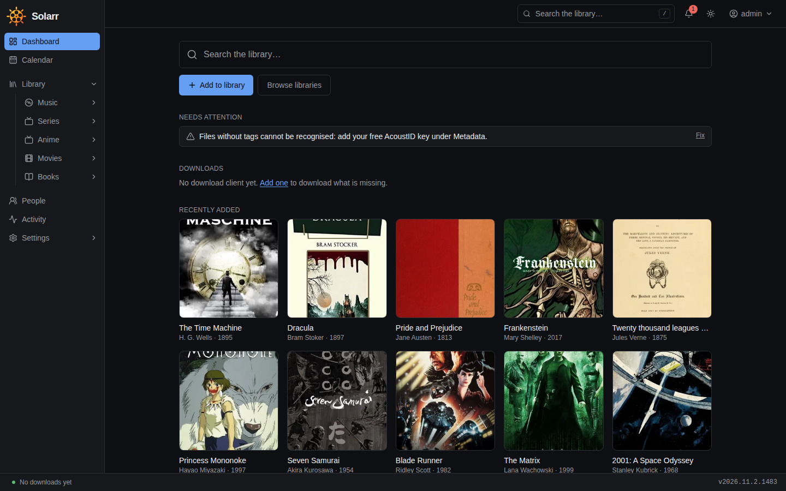
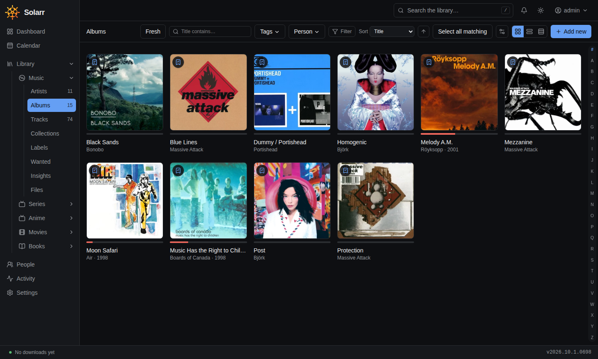
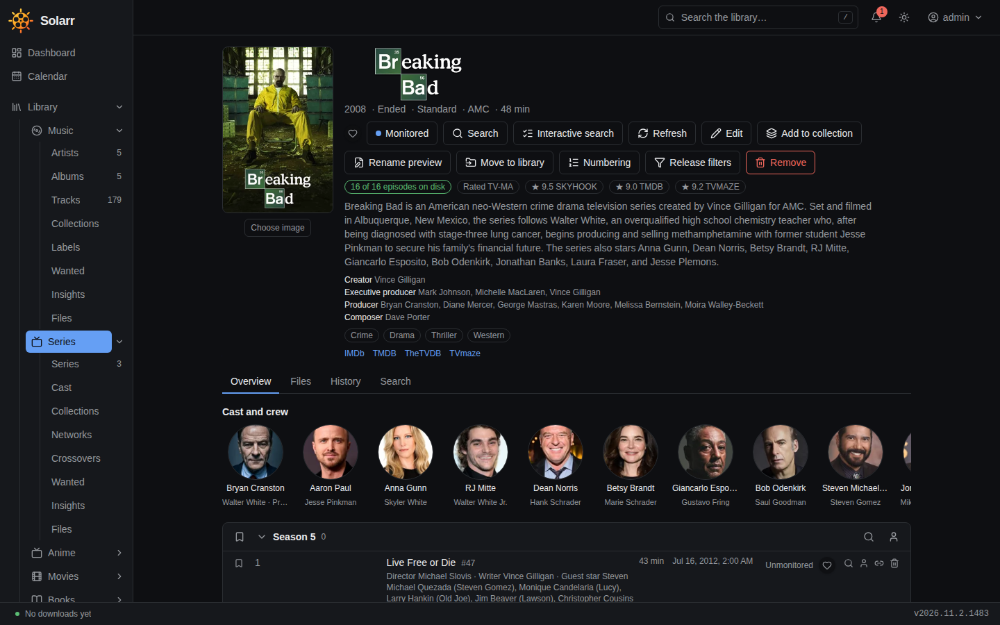
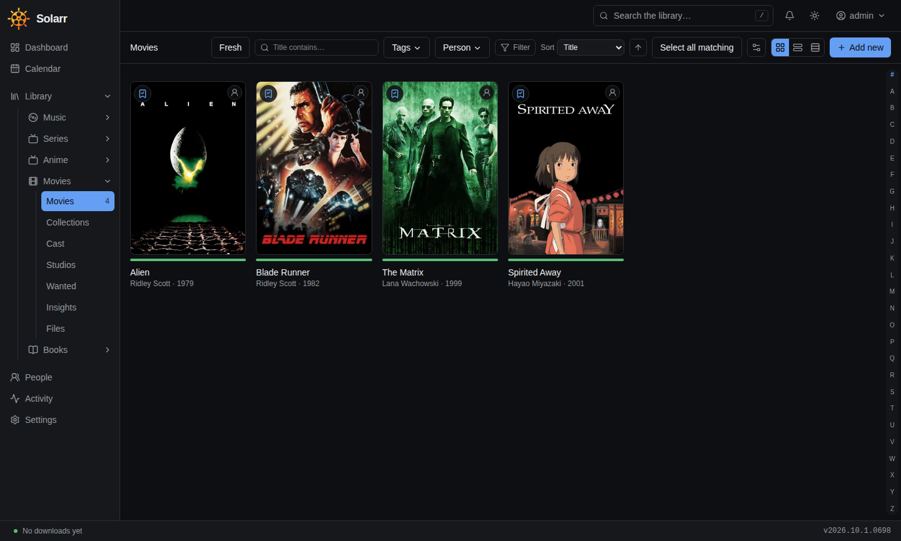
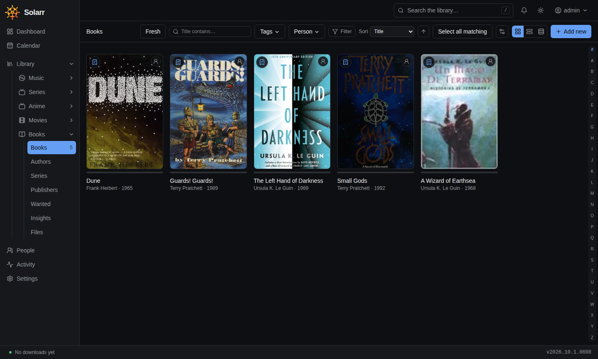
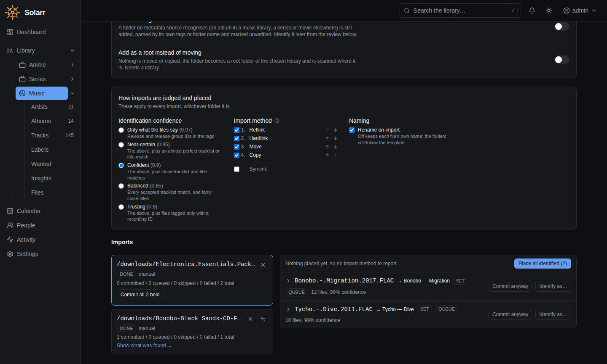
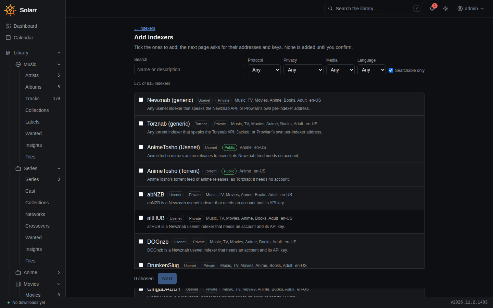
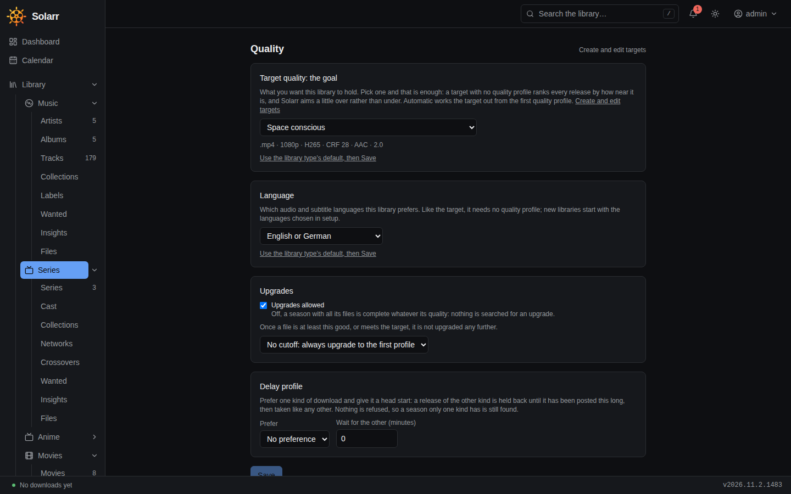
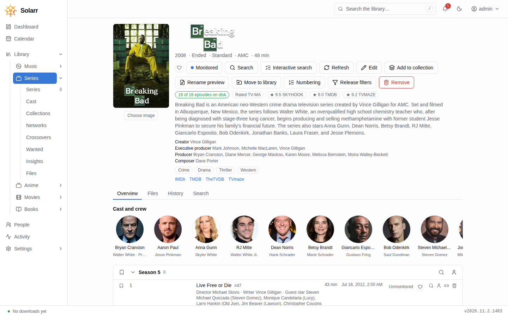

<p align="center"></p>

<h1 align="center">Solarr</h1>

<p align="center"><b>Your media library, managed properly.</b><br>
Music, TV, anime, movies, books, audiobooks and comics. One app. No more <code>New folder (3)</code>.</p>

<p align="center">
<a href="#quick-start">Quick start</a> ·
<a href="#features">Features</a> ·
<a href="documentation/README.md">Documentation</a> ·
<a href="#how-you-can-help">How you can help</a>
</p>

<p align="center"></p>

## What is Solarr?

Solarr is a **self-hosted media manager**. You point it at the folders where your media already lives, and it:

1. **works out what every file is**, from tags, tracklists and what the file really contains, not just its name;
2. **fills in the picture**: covers, posters, cast, descriptions, ratings, collections;
3. **tidies up**, if you want: one consistent folder structure any media server understands;
4. **keeps it complete**: finds what is missing, and better copies of what you have, through your indexers and download client;
5. **lets you browse and play** it all in a fast web interface.

Think Lidarr, Sonarr, Radarr, Readarr and friends, rolled into one app that also explains itself. Every decision shows
its reasons, every irreversible step is previewed first, and nearly everything can be undone in one click.

> ⚠️ **Early alpha.** Solarr is young and moves fast. Mount your library **read-only** (or point Solarr at a copy) until
> you trust it. It will not eat your files, but you should not have to take a stranger's word for that.

## Why you might like it

- **Messy folders are the normal case.** Point it at any folder, any depth. It inspects, shows a preview, and an import
  can be undone as a whole. On a real library of about 200,000 audio files, 99.9 % were recognised on the first scan.
- **One app, many libraries.** Kids' library, partner's audiobooks, your questionable 90s eurodance phase: separate
  libraries, separate rules, separate logins.
- **It judges the file, not the release name.** Fake "1080p" upgrades are refused; ties keep what you have; no upgrade loops.
- **Nothing is deleted behind your back.** Everything goes to a recycle bin first, and every byte is stored once.
- **Fast with huge libraries.** A filtered page of a 500,000-file library comes back in a few milliseconds.
- **Private.** No telemetry, no accounts, no phoning home. It contacts only what you configure.

## Quick start

```yaml
# docker-compose.yml
services:
  solarr:
    image: makearr/solarr:latest       # also ghcr.io/makearr/solarr; amd64 and arm64
    container_name: solarr
    restart: unless-stopped
    environment:
      PUID: 1000
      PGID: 1000
      TZ: Europe/Berlin
    ports:
      - "5454:5454"
    volumes:
      - ./config:/config               # settings and databases: local disk, not NFS/SMB
      - /srv/media:/media:ro           # your library; drop :ro once you trust Solarr
      - /srv/downloads:/downloads      # the same path your download client reports
```

Run `docker compose up -d`, open **http://localhost:5454**, and the setup wizard asks for two things: an administrator
account and your first library (a name, a type, a folder). Solarr scans straight away; you can browse while covers
arrive. Afterwards the dashboard tells you what is still missing, such as an indexer or a download client.

**Next:** [getting started](documentation/getting-started.md) (15 minutes, first download included) ·
[the Docker image](documentation/docker-image.md) (`docker run`, mounts, GPU, memory) ·
[environment variables](documentation/environment-variables.md) (none is required).

## A quick look

| | |
|---|---|
| [](documentation/screenshots/music-albums.png) **Music**: albums as a poster wall, table or overview, with filters and bulk edit | [](documentation/screenshots/tv-series-page.png) **A series**: ratings from every source, cast, seasons and the file behind each episode |
| [](documentation/screenshots/movies.png) **Movies**: posters, editions, collections and franchises | [](documentation/screenshots/books.png) **Books and audiobooks**: authors, series, covers and narrators |
| [](documentation/screenshots/import-preview.png) **Import**: a preview of what each folder becomes, before anything moves | [](documentation/screenshots/indexer-catalog.png) **Indexers**: from Prowlarr, or from the built-in catalogue |
| [](documentation/screenshots/quality-settings.png) **Quality**: pick a target and you are done; profiles when you want more | [](documentation/screenshots/tv-series-page-light.png) **Light or dark**, following your system |

<sub>Screenshots are from a demo instance with silent and blank placeholder files, which is why every episode is the
same tiny 720p file.</sub>

## Features

Each feature has its own page: what it does, why you would want it, and how it works underneath.
The full list: [documentation/features](documentation/features/README.md).

### Core: what Solarr is for

| Feature | What you get |
|---|---|
| [**Libraries and media types**](documentation/features/libraries.md) | Music, TV, anime, movies, books, audiobooks, comics and manga (adult optional, off by default). Any number of libraries, mixed types allowed, one file shared by two libraries |
| [**Recognition and import**](documentation/features/recognition.md) | Any folder, any depth. Embedded ids, whole-tracklist matching, tags, optional audio fingerprints. Preview first, undo the whole import in one click |
| [**Metadata**](documentation/features/metadata.md) | Several providers per library in an order you choose; free keyless sources out of the box; ratings, pictures, collections and franchises |
| [**Hunting and downloads**](documentation/features/hunting.md) | A planner searches within an hourly budget, plus RSS sync and upgrade hunting. Prowlarr, Newznab/Torznab or the built-in indexer catalogue; SABnzbd, NZBGet, qBittorrent, Transmission, Deluge and more |
| [**Quality**](documentation/features/quality.md) | Judged from the measured file. Upgrades must strictly win, ties keep yours, fakes are blocked by their exact bytes |
| [**Files, folders and storage**](documentation/features/storage.md) | \*Arr-style naming with rename previews, many disks per library, one-button disk drain, recycle bin, duplicates merged into one copy |
| [**Moving over from the \*Arrs**](documentation/features/arr-migration.md) | Reads your Lidarr, Sonarr, Radarr, Readarr, Whisparr and Prowlarr setup (only ever reads), preview and mapping, no renames on adoption |

### Advanced: for when you are hooked

- [**Preview player**](documentation/features/player.md): play anything in the browser, as a bar, corner window or full
  screen; converted on the fly (GPU on Intel and AMD) when the browser cannot play it.
- [**Transcoding**](documentation/features/transcoding.md): convert a library to its target quality in the background;
  originals kept and restorable.
- [**Discover and import lists**](documentation/features/discover.md): recommendations per library from the charts of
  its sources, optional automatic adding with a preview.
- [**Users and interface levels**](documentation/features/users.md): several accounts with access per library,
  requests, and a normal / advanced / expert interface.
- [**Automation and activity**](documentation/features/automation.md): a scheduler you can watch and pause, activity
  and history, calendar with a subscribable link, statistics, health checks, backups.
- [**Media servers and webhooks**](documentation/features/connections.md): Jellyfin, Emby, Navidrome, Komga, Kavita,
  Audiobookshelf, Calibre and Stash told about new files; webhooks to Discord, Slack, ntfy, Gotify and Apprise.
- [**Privacy and security**](documentation/features/privacy.md): no telemetry, encrypted secrets, every outbound request
  through one guarded client.

## Coming from the \*Arr stack?

Solarr replaces **Lidarr, Sonarr, Radarr, Readarr, Whisparr and Huntarr** with one engine. It feels familiar on purpose
(add dialogs, monitor options, naming tokens, Wanted, *Cutoff unmet*, quality profiles), so you are not starting from
zero. It is not a port and not API-compatible: the \*Arrs' data model cannot express editions, packs, or one file shared
between libraries. Your download clients and Prowlarr stay as they are.

The safest way to try it: run it **beside** your \*Arrs, let it read their setup, and decide later. The comparison
table and the details are on [moving over from the \*Arrs](documentation/features/arr-migration.md).

## How you can help

Solarr has been tested on exactly one person's library. Yours is different, and that is precisely what makes it useful.
In order of how much it helps:

1. **Report every bug you hit**, with as much detail as you can: version (bottom right of the interface), what you did,
   what you expected, what happened, and the messages from *Settings → Logs*. [Open an issue](https://github.com/makearr/Solarr/issues).
2. **Test recognition on your library.** Does Solarr recognise most of it? Report what it misses or gets wrong, with
   the file name and folder (anonymised is fine) and, if you can, the correct item at a provider.
3. **Test the \*Arr import.** Point Solarr at your Lidarr, Sonarr, Radarr or Readarr (it only reads) and report what
   came across wrong.
4. **Test transcoding on NVIDIA hardware.** The NVENC path is written but untested: there is no NVIDIA GPU in the project.
5. **Test with Plex.** There is no Plex server here either. Does Plex read a Solarr-organised library correctly?
6. **Benchmark a library import.** How long did the first scan take, with how many files, on what hardware and storage?
7. **Point an AI agent at the code** to hunt for bugs, performance traps and security vulnerabilities, and send the report.

Security vulnerabilities go **privately** through [GitHub's advisory form](https://github.com/makearr/Solarr/security/advisories/new),
not a public issue ([SECURITY.md](SECURITY.md)). Code contributions: [CONTRIBUTING.md](CONTRIBUTING.md). And of course:
star the repository and tell a friend with a messy hard drive.

### Let your AI agent do the legwork

Got a coding agent (Claude Code, OpenAI Codex, Qwen Code, ...) and spare usage? The [agent briefs](agents/README.md) tell
it exactly what to do and produce a report you post with your own GitHub account:

| Brief | Your agent... |
|---|---|
| [recognition-test.md](agents/recognition-test.md) | runs a throwaway Solarr against your library (**read-only**), measures recognition, lists what went wrong, optionally tests the \*Arr import |
| [recognition-benchmark.md](agents/recognition-benchmark.md) | measures how long recognition takes on your hardware, and what it costs |
| [code-review.md](agents/code-review.md) | reviews one area of the code for bugs, performance traps and security vulnerabilities |

Just tell it: *"Read `agents/recognition-test.md` in https://github.com/makearr/Solarr and follow it."* The briefs keep
your library read-only, keep your keys out of the report, and ask you before any file name ends up in it.

## Built with AI

Let's be honest up front: **Solarr would not exist without AI**, and the interesting part is how that works.

**The architecture was designed by a human. The typing was done by AI.** Everything that decides what Solarr *is* was a
human decision: the functionality, the generic core with media types as declarations, the database architecture (the
four-way split, WAL mode, the priority writer queue), the quality model, the safety rules.

- **[Claude Code](https://claude.com/claude-code)** wrote the code, the tests, the migrations and the documentation against that design.
- **Claude Fable 5.2** helped plan the advanced features: working out designs, poking holes in them, and writing the plans the code was built from.
- **Other AI agents** (OpenAI Codex, Qwen Code and others) are used as a second pair of eyes for bug and security
  vulnerability hunting. Agents from different vendors disagree in useful ways.
- **A heavy human validation loop.** Every feature was reviewed, argued with, sent back and re-checked. "Did you actually
  look at it, or did the tests just pass?" is a sentence that gets said a lot in this project.
- **Automated checks at every step**: strict Go static analysis and linting, the race detector, generated-code checks,
  and latency budgets that fail the build when missed.
- **Tested on a real library** of about 250,000 files, **without a backup**. If that does not show the author trusts it,
  nothing will. (You should still make one. Do as I say, not as I do.)

| | |
|---|---|
| Development started | 31 August 2026 (about 12 weeks ago, as of the end of November 2026) |
| Go | about 380,000 lines, of which about 150,000 are tests |
| TypeScript (web interface) | about 50,000 lines |
| Commits | over 3,000 |

The ideas, the taste and the stubbornness are human; the typing is very much not. Read the
[coding standards](documentation/coding-standards.md) and judge the result yourself.

## Documentation

| | |
|---|---|
| **Start here** | [Getting started](documentation/getting-started.md) · [User guide](documentation/user-guide.md) · [Features](documentation/features/README.md) |
| **Installing** | [The Docker image](documentation/docker-image.md) · [Environment variables](documentation/environment-variables.md) · [Container runtime](documentation/container-runtime.md) |
| **Under the hood** | [Architecture and why Go](documentation/architecture.md) · [Benchmarks and resource use](documentation/benchmarks.md) · [Database layout](documentation/database-layout.md) |
| **Contributing** | [How to help](CONTRIBUTING.md) · [Building it yourself](documentation/building.md) · [Codebase map](documentation/codebase-map.md) · [Coding standards](documentation/coding-standards.md) |
| **Everything** | [The documentation index](documentation/README.md) · [Changelog](CHANGELOG.md) |

## Licence

[AGPL-3.0-or-later](LICENSE). Free to use, modify and self-host. If you run a modified version as a service for others,
you must make your changes available to them. Third-party reuse: [ATTRIBUTION.md](ATTRIBUTION.md).
