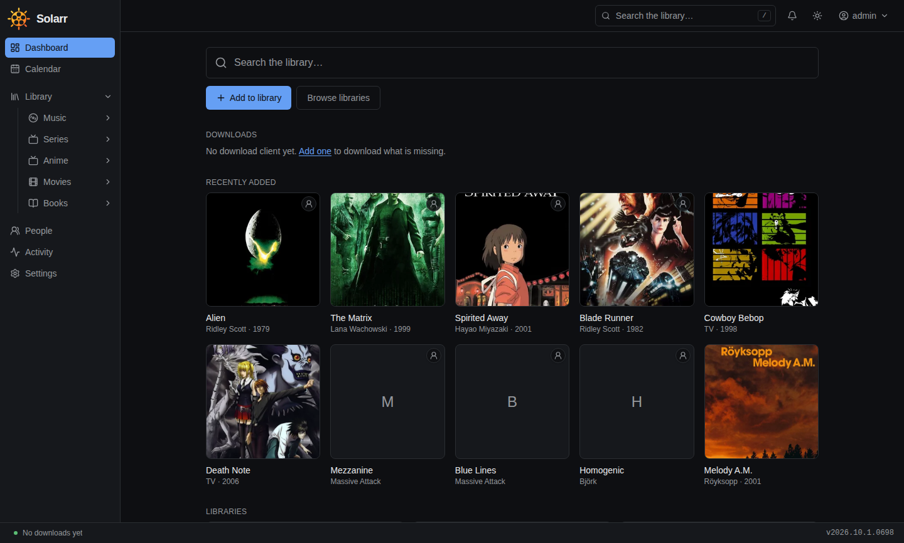
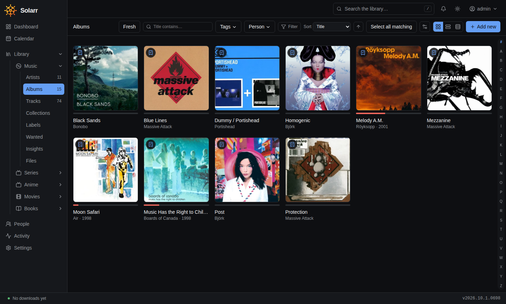
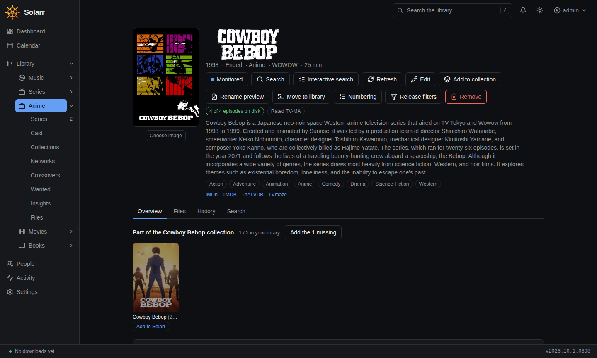
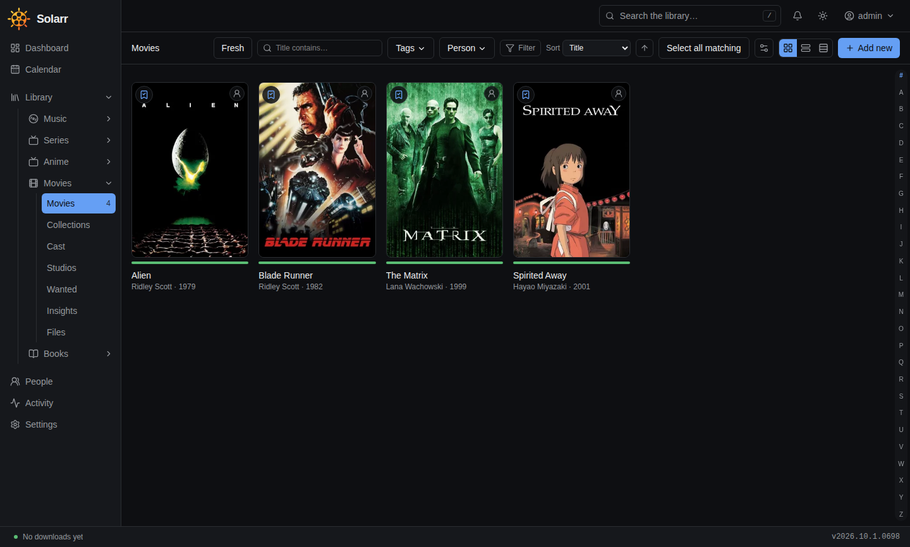
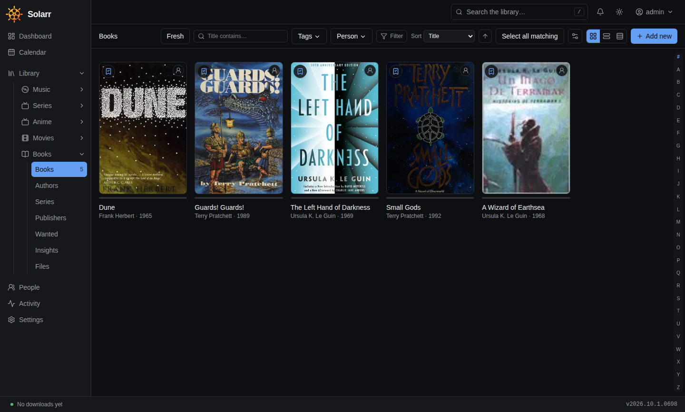
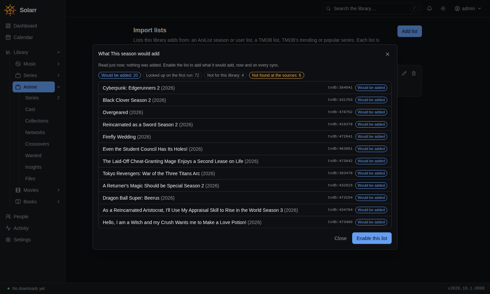
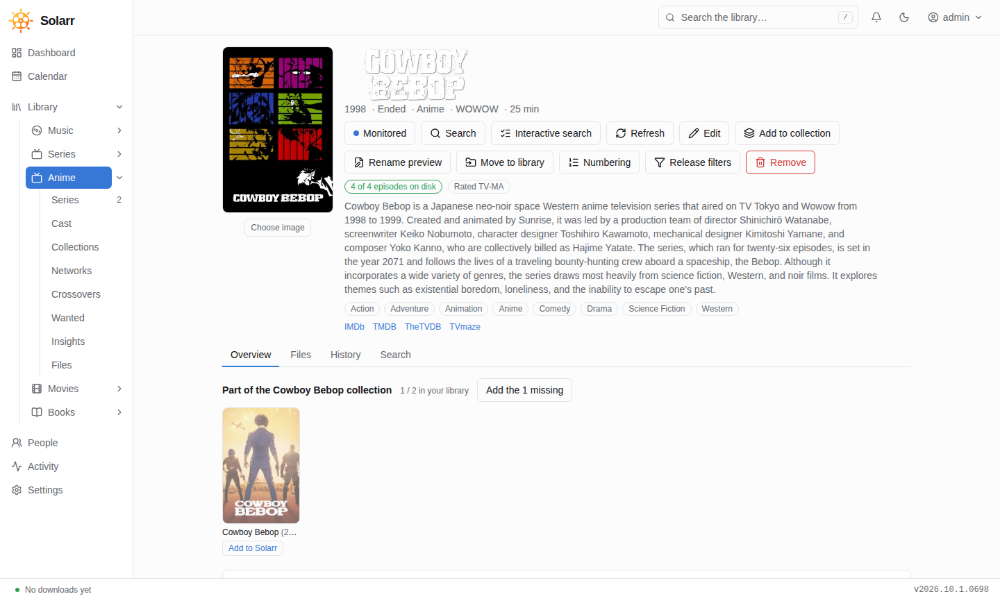

<p align="center"></p>

<h1 align="center">Solarr</h1>

<p align="center"><b>Your media library, managed properly.</b><br>
Turn a hard drive full of disorganised files into a library that is beautiful and playable.</p>

## Table of contents

1. [Introduction](#introduction)
2. [New to media management?](#new-to-media-management)
3. [Installation](#installation)
4. [A quick look](#a-quick-look)
5. [Coming from the \*Arr stack](#coming-from-the-arr-stack)
6. [Standout features](#standout-features)
7. [Privacy](#privacy)
8. [The Docker image](#the-docker-image)
9. [Design decisions](#design-decisions)
10. [Benchmarks and resource use](#benchmarks-and-resource-use)
11. [Why Go, and how responsiveness works](#why-go-and-how-responsiveness-works)
12. [Compiling it yourself](#compiling-it-yourself)
13. [Contributing](#contributing)
14. [Supporting the project](#supporting-the-project)
15. [Built with AI](#built-with-ai)
16. [Changelog](#changelog)

---

## Introduction

**Solarr** is a self-hosted media manager. You point it at the folders where your music, shows, films and books
already live. It works out what every file is, fetches the covers, posters, cast lists and descriptions, renames
and sorts files into a tidy structure if you want that, and shows the result in a fast web interface where you can
browse it, play it and keep it complete. It can also go looking for the things you are missing, and for better
copies of the things you have.

Every kind of media gets its own **library**, with its own folders, quality wishes, naming rules and users.

| Library type | What it holds |
|---|---|
| **Music** | Artists, albums, editions, labels |
| **TV series** | Series, seasons, episodes, networks, cast |
| **Anime** | Like TV, with absolute numbering and anime titles and relations |
| **Movies** | Films, editions, collections and franchises |
| **Books** | Authors, series, covers |
| **Audiobooks** | Like books, plus narrators |
| **Adult** (optional, off by default) | Scenes, films and performers |

A library can also **mix types** (a "Kids" library with series and films side by side), and documentaries, live
recordings or concerts are just libraries of the type they resemble.

<p align="center"></p>

> ⚠️ **Early alpha.** Solarr is young and the database schema can still change. Point it at a copy of your
> library, or mount your library **read-only**, until you trust it. Please [report problems](#supporting-the-project):
> that is how it gets better.

---

## New to media management?

Imagine the hard drive. Ten years of music ripped, bought and downloaded. Shows saved as
`Show.Name.S02E05.720p.WEB.x264-GRP.mkv`, films in folders called `New folder (3)`, an album that exists as two
half-copies under different spellings. Everything is *there*, but nothing is *findable*, nothing has a cover, and
your media server shows half of it under the wrong name.

A media manager sits between your files and the programs that play them and fixes that:

- **It recognises what you have.** Not by trusting the file name, but by reading the tags, the track lists, the
  durations and what the file really contains.
- **It names and sorts.** One consistent folder structure that any player understands, chosen by you.
- **It fills in the picture.** Covers, posters, cast, biographies, ratings, release dates, collections.
- **It knows what is missing.** The album you own 9 tracks of, the season that stops at episode 6, the sequel you
  never got.
- **It keeps what you have in good shape.** It can find a better copy, and refuses a fake one.
- **It lets you play it.** Browse and preview in the browser; your media server picks up the tidy result.

**What Solarr brings to the table** is doing all of this for *every* media type in one program, with one interface
that is built to be understood without reading a manual: every decision shows its reasons, every irreversible
step is previewed first, and nearly everything can be undone in one click. Messy folders are the normal case, not the
exception: Solarr is built for them.

New here? [Getting started](documentation/getting-started.md) takes 15 minutes, and the
[user guide](documentation/user-guide.md) is the full walk-through.

---

## Installation

Solarr ships as one Docker image for **amd64 and arm64**:
[`makearr/solarr`](https://hub.docker.com/r/makearr/solarr) on Docker Hub (also on `ghcr.io/makearr/solarr`).

**Docker command**

```sh
docker run -d --name solarr \
  --restart unless-stopped \
  -e PUID=1000 -e PGID=1000 -e TZ=Europe/Berlin \
  -p 5454:5454 \
  -v /srv/solarr/config:/config \
  -v /srv/media:/media \
  -v /srv/downloads:/downloads \
  makearr/solarr:latest
```

**Docker Compose**

```yaml
# docker-compose.yml
services:
  solarr:
    image: makearr/solarr:latest
    container_name: solarr
    restart: unless-stopped
    environment:
      PUID: 1000
      PGID: 1000
      TZ: Europe/Berlin
    ports:
      - "5454:5454"
    volumes:
      - ./config:/config        # settings, databases, backups: local disk, not NFS/SMB
      - /srv/media:/media       # your library (add :ro while you try it out)
      - /srv/downloads:/downloads   # the same path your download client reports
```

Start it with `docker compose up -d` and open **http://localhost:5454**. A ready-made, commented
[docker-compose.yml](docker-compose.yml) is in the repository.

### The setup wizard

The first visit opens a short wizard. It asks for two things:

1. **An administrator**: a user name and a password.
2. **Your first library**: a name, a type (music, TV, movies, ...) and the folder it lives in.

Solarr scans the folder straight away and you can browse while covers and posters arrive over the next few
minutes. Afterwards the dashboard tells you what is still missing (an indexer, a download client). Connect those
under *Connections*, or let Solarr [read them from Prowlarr and your \*Arrs](#coming-from-the-arr-stack).

For mounts, permissions, GPU access and every setting, see [the Docker image](#the-docker-image) below and
[getting started](documentation/getting-started.md).

---

## A quick look

| | |
|---|---|
| [](documentation/screenshots/music-albums.png) **Music**: albums as a poster wall, with table and overview views, filters and bulk edit | [](documentation/screenshots/tv-series-page.png) **A series**: cast, collections, seasons and, per episode, the file on disk |
| [](documentation/screenshots/movies.png) **Movies**: posters, editions, collections and franchises | [](documentation/screenshots/books.png) **Books and audiobooks**: authors, series, covers and narrators |
| [](documentation/screenshots/import-lists.png) **Import lists**: previewed before you enable them | [](documentation/screenshots/tv-series-page-light.png) **Light or dark**, following your system |

<sub>Screenshots are from a demo instance. Its files are silent or blank placeholders, which is why every track
is the same FLAC and every episode the same 720p H.264.</sub>

---

## Coming from the \*Arr stack

Solarr replaces **Lidarr, Sonarr, Radarr, Readarr, Whisparr and Huntarr** with one engine. It is not a port and
not API-compatible, on purpose: the \*Arrs' data model cannot express editions, packs, or one file shared between
libraries. What you get instead:

- **Lidarr, Sonarr, Radarr.** Their add dialogs, monitor options, naming tokens, Wanted and *Cutoff unmet* lists
  and quality profiles are all there, so it feels familiar. Beyond them: any number of libraries per media type, whole-tracklist
  album matching, a pack or box set that becomes many correctly named albums or seasons, archives read in place
  instead of unpacked, quality judged from the real file, and one copy of a file shared by two libraries.
- **Readarr.** Books and audiobooks are real libraries: authors, series (with the books a series still lacks),
  narrators, *follow an author*, and several providers (Open Library, Google Books, Hardcover, FantLab, iTunes, Audible
  with Audnexus) in an order you choose per library. Readarr's own metadata service is not needed.
- **Whisparr.** An optional adult library type over the stash-box providers, ThePornDB and Whisparr's metadata:
  scenes, films, performers and a StashDB favourites import list. Whisparr is also an import source.
- **Huntarr.** Hunting is built in, not bolted on: a planner decides what to search for and when, inside an hourly
  budget you set, with RSS sync, upgrade hunting, held releases when the client is full, free-space gating and a
  per-item explanation of when it was searched and why it is waiting.
- **Prowlarr.** Solarr does not replace it: it does not implement indexers itself. Point it at Prowlarr (or any
  Newznab/Torznab indexer) and it also offers Prowlarr's catalog to choose indexers from.
- **Moving over.** Solarr reads your Lidarr, Sonarr, Radarr, Whisparr and Prowlarr setup (it only ever *reads*),
  shows a preview and a mapping step, and lets you pick what to bring across. Its naming defaults match theirs, so
  adopting an existing library proposes **no renames**. Monitoring can optionally be sent back to the \*Arr. The
  download client and SABnzbd/qBittorrent stay as they are. See [arr-import](documentation/arr-import.md).

Running Solarr **beside** your \*Arrs while you decide is the safest way to try it.

<details>
<summary><b>Feature comparison table</b></summary>

| | Lidarr / Sonarr / Radarr / Readarr / Whisparr | Solarr |
|---|---|---|
| Media types | One per app | Music, TV, anime, movies, books, audiobooks (adult optional) in one app |
| Libraries | One per instance | Any number, each with its own folders, quality, users and rating limit; mixed types allowed |
| Searching | You press *Search all* (Huntarr-style tools add a loop) | A planner hunts within a budget, plus RSS and upgrade hunting |
| Full download client | Grabs fail or wait | Held releases, sent in priority order as the client frees up |
| Import | Sorted folders, one at a time | Any folder, any depth, previewed, fully revertible |
| Packs and box sets | Weak | One download becomes many albums or seasons |
| Archives | Extracted | Read in place, never unpacked into the library |
| Unrecognised music | Stuck in the import screen | Visible as an unverified album |
| Fakes | Blocklist by release name | Blocks the exact bytes and wants the item again |
| Quality | Ordered format list | Gates, tiers and a score, judged from the real file; ties keep yours |
| Why did it do that? | A rejection string | Structured reasons kept per decision |
| Metadata | One source per app | Several per library, in an order you choose |
| Several disks | Root folders | Affinity, read-only / offline / draining, one-button drain |
| Same file twice | Two copies | One copy, linked (reflink or hardlink) after a preview |
| Crossover episodes | One series only | Held once, placed in both series |
| Franchises | TMDB collections (movies) | Collections plus Wikidata franchises for movies and series |
| Deleting | Optional recycle bin | Always recycled first |
| Users | One login | Several, with per-library access |
| Preview player | None | In the browser, with transcoding |
| Settings | One long list | Normal / advanced / expert |
| Deployment | One .NET app per media type | One Go binary, four small SQLite databases |
| Notifications | Many connectors | In-app centre only for now |
| **Maturity** | Years in production | **Early alpha** |

</details>

---

## Standout features

### Preview media player

Press play beside any track, episode or film. The player lives in the page frame, so it keeps playing while you
browse, as a **bar**, a **corner window** or **full screen**. Files a browser can play are streamed as they are;
for the rest Solarr converts on the fly (**GPU transcoding** on Intel and AMD when a device is passed in), with a
quality menu (original, 1080p, 720p, 480p) and the source bitrate shown. See [media player](documentation/media-player.md).

### Several users, access per library

Give each person their own login and decide which libraries they may see or manage. A kids' account sees the kids'
library; a housemate manages the music. Views, filters, favourites (a heart on works, people and collections) and
interface level are remembered **per user**. There is also a proxy-header mode for single sign-on set-ups.

### Better recognition

Point Solarr at **any folder, at any depth**. It identifies by evidence, in order: embedded IDs, **whole-tracklist
matching** (durations, positions, titles), per-file search, folder names and, optionally, **AcoustID audio
fingerprints** for files with no tags at all. On a real library of about 200,000 audio files **99.9% were
identified** on the first scan. You see a **preview first**, then commit, and you can **undo the whole import in
one click**. Music nothing recognises becomes a visible *unverified* album instead of sitting in an import screen for
ever. See [music identification](documentation/music-identification.md).

### Hunting

A planner works out which wanted items may be searched and how urgently (new releases first, then the rest, with a
backoff that doubles from 6 hours to a week) and a scheduled hunt searches the most urgent within an hourly budget
you set. **RSS sync** grabs new releases as they appear, **upgrade hunting** replaces a file only when the new one
*strictly* wins, and **held releases** wait in priority order when the download client is full. Failed or fake
releases are blocklisted by release *and* by content hash. See [downloads](documentation/downloads.md).

### Libraries that span many disks

Any number of root folders per library. An artist or series stays on one disk, new content goes where there is room,
and **retiring a disk is one button**. Details in [storage modes](#storage-modes).

### Quality management

The **file is the evidence, not the release name.** Solarr measures what it downloaded with ffprobe, so fake
upgrades are refused, ties keep what you have, and a bigger number does not automatically win (192 kHz does not beat
a clean 48 kHz just for being larger). Profiles cover formats, codecs, bit depth, resolution, HDR, audio and
subtitle languages and preferred release groups. **Remove and block** recycles a bad file, blocks its exact bytes
and wants the item again. See [library quality](documentation/library-quality.md).

### Deduplication

Solarr treats duplicates as something to find and merge, never to delete blindly:

- **One copy, many places.** Imports link reflink, then hardlink, then copy, so a download you keep seeding and the
  library file take the space once. Identical copies of one file within a library become **one copy** after a preview, and an episode
  listed under two series is linked into both folders.
- **Same file, different name.** *Remove and block* blocks the exact bytes by content hash, so a bad file under another
  release name is refused, and a replacement is recorded and shown side by side with the file it replaced. A file linked at many paths counts as one
  video.
- **Similar videos.** The same footage in another encode, resolution, frame rate, container or with black bars is found by
  perceptual hashes of nine moments plus duration, across one library or all of them, at five similarity levels (exact to
  lowest). Keep one copy: the others are **merged** (hardlink or reflink, same library) or **recycled**, and delete is
  offered on every file or a whole group. Hashing costs CPU, so it is **off by default**; previews (a frame and a
  3x3 sheet) come from the same pass.
- **Everything recoverable.** Removed copies wait in the recycle bin first.

See [duplicate videos](documentation/duplicate-videos.md) and the [storage guide](documentation/guide/storage.md).

### And more

- **Similar videos report**: perceptual hashes find the same video in two files; keep one, link or recycle the others.
- **Import lists** for TV (an AniList season, a TMDB list, trending shows), previewed before you enable them.
- **Collections and franchises** beyond TMDB's, from Wikidata and AniList.
- **Everything from the browser**, with settings at *normal*, *advanced* or *expert* level.
- **Calendar** with a subscribable link, **statistics**, and a **cache and memory page**.

---

## Privacy

Solarr is **privacy-first and localhost-first**.

- **No telemetry, no analytics, no crash reporting, no accounts, no update check.**
- It contacts **only what you configure**: the metadata providers enabled for your libraries, your indexers, your
  download clients and, if you use the import, your \*Arr instances.
- The one optional extra, a check of your public IP (to see whether traffic leaves past a VPN), runs **only while
  you show the address in the status bar** (hidden by default), or on a schedule if you turn it on.
- Secrets (API keys, passwords) are **encrypted at rest** and never returned by the API.
- Every outbound request goes through one HTTP client with a destination guard (SSRF protection) and can be
  routed through a proxy.

**Don't take our word for it.** The code is open: point your own AI (or your own eyes) at it and ask where it
connects to. Everything outbound passes through `internal/platform/httpx`.

---

## The Docker image

One image, **amd64 and arm64**, from Docker Hub (`makearr/solarr`) and GitHub (`ghcr.io/makearr/solarr`).

### Size, and keeping it lean

| | Measured |
|---|---|
| Download from Docker Hub (compressed, amd64 / arm64) | about **84 MB / 81 MB** (first release) |
| On disk after pulling (current build) | about **187 MB** |
| The Solarr binary itself, web interface included | about **36 MB** |

The Go binary is static (`CGO_ENABLED=0`) with the interface embedded: no .NET runtime, no Node, no database
server, no message broker. The rest is a small Alpine base plus the few tools Solarr needs: `ffprobe`/`ffmpeg`
(measuring files, the player), `fpcalc` (audio fingerprints) and a tag writer. GPU drivers for Intel and AMD are
included and cost nothing unless you pass a device in. The image is built to stay lean: each addition is weighed
against its size (the tag writer, for example, was accepted at +57 MB and is noted as such in the Dockerfile),
and zoneinfo and certificates are copied rather than installed.

### Memory

| Library | RAM to plan for |
|---|---|
| **Small** (a few thousand items) | **256 MB** is comfortable. A fresh instance idles at about **45 MB** resident (measured) |
| **Large** (250,000+ files) | **1 GB** is a sensible budget. The database page caches have a designed ceiling of **384 MiB** in total (default), enforced by a test, and the rest is Go working memory |

The idle figure is measured; the large-library figure is the designed ceiling plus headroom, **not** a
measurement on a full 250,000-file library yet. Treat it as a budget and tell me what you see.

**More RAM for the cache.** *Settings → Cache* sets one ceiling for the page caches of all four databases
(`database.cache_size_kb`, default 384 MiB, at least 128 MiB; the library database takes 80%). On a machine with RAM to
spare, raise it until most of a large library is served from memory; it applies at the next start. The page shows each
database's file size, cache use and hit ratio, so you can see whether more would help, and a **Shrink** button drops
pictures and provider answers unused for a week.

**Database and cache on tmpfs / shm (expert, off by default).** Two options run a working copy from RAM and write it
back on an interval: the **cache** (cover pictures not yet in the library, and the provider-response database; every
10 minutes) and the **four databases** (every 5 minutes, only those that changed). The RAM directory is `/dev/shm/solarr`;
its size is Docker's `shm_size`, so give the container room:

```yaml
    shm_size: 8gb
    stop_grace_period: 2m
```

Solarr turns an option on only when the directory is at least 20% larger than what it would hold and the container's
memory allows it, and it needs "I understand the risk" ticked. Everything is copied to disk at once on shutdown. **A
crash, kill or power cut loses what changed since the last copy**; backups are unaffected. If the container's free
memory falls below a twentieth of its limit, Solarr copies to disk, switches the cache (then the databases) off and
restarts from disk. Details: [RAM copies](documentation/memory-copies.md).

Features that start `ffmpeg` (the player's conversions, video hashing) use extra memory and CPU while they run; see
[benchmarks and resource use](#benchmarks-and-resource-use).

### Mounts and permissions

- **`PUID`/`PGID`** set who Solarr runs as; it takes ownership of its own folders only, never your media. Don't set `user:`.
- **Keep `/config` on local storage.** SQLite is not reliable over NFS/SMB.
- **Hardlinks need one filesystem**: put the library and completed downloads on the same mount, or Solarr copies instead.
- Mount your library `:ro` while you are trying Solarr out.
- Port 5454 can be changed with `SOLARR_PORT`.

More in [container runtime](documentation/container-runtime.md).

### Environment variables

**None is required.** A variable that is set wins over `config.yml` and over a value saved in the web interface; an
unset one changes nothing. Append `_FILE` to any `SOLARR_*` variable to read it from a file (Docker secrets). Any
other `config.yml` key is `SOLARR_` plus its path in upper case with dots as underscores. Everything, with
precedence rules: [environment variables](documentation/environment-variables.md).

<details>
<summary><b>All environment variables</b></summary>

**Container**

| Variable | Default | Meaning |
|---|---|---|
| `PUID` / `PGID` | `1000` | User and group the process runs as, and the owner of everything it writes. `0` is refused |
| `TZ` | `UTC` | Time zone for air dates and log timestamps |
| `SOLARR_HEALTHCHECK_DNS` | unset | A host name the healthcheck must also resolve (instances behind a VPN container) |

**Location and network**

| Variable | Default | Meaning |
|---|---|---|
| `SOLARR_CONFIG_DIR` | `/config` | Directory holding `config.yml` |
| `SOLARR_DB_DIR` | `/config/db` | `library.db`, `settings.db`, `jobs.db`, `statistics.db`. Local disk only |
| `SOLARR_CACHE_DIR` | `/config/cache` | Disposable cache: pictures of items not in the library yet, provider responses, the transcode scratch folder |
| `SOLARR_MEDIACOVER_DIR` | `/config/mediacover` | Pictures of items in the library; never evicted |
| `SOLARR_BACKUP_DIR` | `/config/backups` | Database backups |
| `SOLARR_PORT` | `5454` | HTTP port |
| `SOLARR_BIND` | `0.0.0.0` | Address to listen on |
| `SOLARR_BASE_URL` | `/` | Path prefix behind a reverse proxy under a sub-path, e.g. `/solarr` |
| `SOLARR_PROXY_URL` | unset | Outbound proxy (`http://`, `https://` or `socks5://`, with a port) |

**Media folders**

| Variable | Default | Meaning |
|---|---|---|
| `SOLARR_ROOT_FOLDERS` | unset | Comma-separated absolute paths, optionally labelled: `Music=/media/music,TV=/media/tv`. Never removed by dropping a path |

**API keys** (stored encrypted in `settings.db`)

| Variable | Provider | Without a key |
|---|---|---|
| `SOLARR_TMDB_API_KEY` | TMDB | TV and movies work on less data |
| `SOLARR_TVDB_API_KEY` | TheTVDB | A built-in project key is used |
| `SOLARR_FANART_API_KEY` | fanart.tv | No fanart |
| `SOLARR_OMDB_API_KEY` | OMDb | No OMDb ratings |
| `SOLARR_MDBLIST_API_KEY` | MDBList | No MDBList ratings |
| `SOLARR_ACOUSTID_API_KEY` | AcoustID | No fingerprint step |
| `SOLARR_THEAUDIODB_API_KEY` | TheAudioDB | The public key is used |
| `SOLARR_GOOGLEBOOKS_API_KEY` | Google Books | Shared quota |
| `SOLARR_HARDCOVER_API_KEY` | Hardcover | Provider unavailable |
| `SOLARR_STASHDB_API_KEY` | StashDB | Provider unavailable |
| `SOLARR_THEPORNDB_API_KEY` | ThePornDB | Provider unavailable |
| `SOLARR_FANSDB_API_KEY` | FansDB | Provider unavailable |

**Security**

| Variable | Default | Meaning |
|---|---|---|
| `SOLARR_ENCRYPTION_KEY` | generated on first run | `base64:` plus 32 random bytes. Encrypts the credentials; keep it if you set it |
| `SOLARR_AUTH_MODE` | `local` | `local`, `proxy`, `apikey_only` or `none` (`none` serves everyone as administrator) |
| `SOLARR_SECURITY_TRUSTED_PROXY_HEADER` | `X-Remote-User` | Header carrying the user name in `proxy` mode |
| `SOLARR_SECURITY_TRUSTED_PROXY_CIDRS` | empty | Proxies allowed to set that header, e.g. `[10.0.0.0/8]` |

**Logging and mode**

| Variable | Default | Meaning |
|---|---|---|
| `SOLARR_LOG_LEVEL` | `info` | `debug`, `info`, `warn` or `error` |
| `SOLARR_LOG_FORMAT` | `json` | `json` or `text` |
| `SOLARR_MODE` | `normal` | `normal`, `read_only` (no writes into a library), `pause_downloads`, `observe` (read-only, no searches, no downloads) or `arr_companion` (observe, plus monitoring sent back to the \*Arrs). See [Solarr mode](documentation/solarr-mode.md) |

**Tuning**

| Variable | Default | Meaning |
|---|---|---|
| `SOLARR_DATABASE_BUSY_TIMEOUT` | `15s` | How long a database waits on a lock |
| `SOLARR_DATABASE_PAGE_SIZE` | `4096` | SQLite page size (applied only when a database is created) |
| `SOLARR_DATABASE_CACHE_SIZE_KB` | `393216` | One ceiling (KiB) for the page caches of all databases together; raise it for a large library |
| `SOLARR_MEMORY_CACHE_TMPFS` / `SOLARR_MEMORY_DATABASE_TMPFS` | `false` | Run the cache / the four databases from RAM (`/dev/shm/solarr`), written back on an interval. Expert; see [RAM copies](documentation/memory-copies.md) |
| `SOLARR_MEMORY_CACHE_SYNC_INTERVAL` / `SOLARR_MEMORY_DATABASE_SYNC_INTERVAL` | `10m` / `5m` | How often the RAM copies are written back |
| `SOLARR_MEMORY_TMPFS_DIR` | `/dev/shm/solarr` | The RAM directory; its size is the container's `shm_size` |
| `SOLARR_DATABASE_WRITE_WARN` | `50ms` | A write transaction longer than this is logged |
| `SOLARR_DATABASE_WRITE_HARD` | `2s` | A write transaction longer than this is a fault |
| `SOLARR_BACKUP_SETTINGS_ON_CHANGE` | `true` | Snapshot `settings.db` on every change |
| `SOLARR_BACKUP_KEEP_SETTINGS` | `20` | Settings snapshots kept |
| `SOLARR_BACKUP_BEFORE_MIGRATION` | `true` | Back up before a schema migration (cannot be turned off) |
| `SOLARR_RETENTION_DECISIONS_FULL` | `90d` | How long full decision detail is kept |
| `SOLARR_RETENTION_CANDIDATES` | `7d` | How long search candidates are kept |
| `SOLARR_STORAGE_MIN_FREE_BYTES` | `50GB` | Downloads stop below this much free space |
| `SOLARR_STORAGE_MIN_FREE_PERCENT` | `2` | ...or below this percentage |
| `SOLARR_WORKERS_SEARCH` | `4` | Concurrent searches |
| `SOLARR_WORKERS_ACQUIRE` | `2` | Concurrent downloads started |
| `SOLARR_WORKERS_METADATA` | `4` | Concurrent metadata lookups |
| `SOLARR_NETWORK_PUBLIC_IP_CHECK_ENABLED` | `false` | Periodically ask a third party which address this host connects from |
| `SOLARR_NETWORK_PUBLIC_IP_CHECK_ENDPOINT` | `https://api.ipify.org` | Service for that check |
| `SOLARR_NETWORK_PUBLIC_IP_CHECK_INTERVAL` | `6h` | How often |
| `SOLARR_METADATA_MUSICBRAINZ_BASE_URL` | `https://musicbrainz.org/ws/2` | Direct MusicBrainz, or a local mirror |
| `SOLARR_METADATA_MUSICBRAINZ_BRAINZMASH_ENABLED` | `true` | Try the BrainzMash mirror pool first |
| `SOLARR_METADATA_MUSICBRAINZ_BRAINZMASH_BASE_URL` | `https://api.brainzmash.cc/ws/2` | Its address |
| `SOLARR_METADATA_MUSICBRAINZ_PROXY_ENABLED` | `true` | Try the Servarr metadata proxy next |
| `SOLARR_METADATA_MUSICBRAINZ_PROXY_BASE_URL` | `https://api.lidarr.audio/api/v0.4` | Its address |
| `SOLARR_METADATA_MUSICBRAINZ_REFRESH_AFTER` | `90d` | Age at which a cached answer is fetched again |

`solarr config check` validates the file and the environment without starting the server.

</details>

---

## Design decisions

### Databases

Solarr keeps **four small SQLite databases instead of one large one**, all in **WAL mode**, each with **one
writer**:

| Database | Holds |
|---|---|
| `library.db` | Everything that scales with your media |
| `settings.db` | Configuration and credentials; fully cached in memory |
| `jobs.db` | The work queue: high churn, kept apart |
| `statistics.db` | History and figures; the library stays correct with it empty |

Every write goes through that database's **internal writer queue** with priorities, so **your click jumps ahead of a
bulk scan** and the browser never stalls while Solarr works. No transaction runs over about 50 ms, and bulk work is
split into 200-row batches. The planner is a pure read of state that emits idempotent actions, so it can run often
and cheaply.

Measured on a synthetic **500,000-file library** (`make bench`; CI fails if a target is missed):

| Operation | Typical (p50) | Worst case (p99) | Target |
|---|---|---|---|
| A page of the library list, filtered | 1.7 ms | 3.5 ms | 100 ms |
| Search-as-you-type over titles | n/a | 17 ms | 150 ms |
| Import 200 rows | 3.7 ms | 5.7 ms | 50 ms |
| A user's edit while a bulk write runs | 4.3 ms | 19 ms | 25 ms |

A page 1,000 deep costs the same as page 1, and counts are kept as counters, never a live `COUNT(*)`. More in
[database layout](documentation/database-layout.md) and [benchmarks](documentation/benchmarks.md).

### Metadata providers

Solarr asks **several providers per library type, in an order you choose per library**: the first provider that
knows a field supplies it, each later one only fills what is still empty, and any provider can be switched off.

| Library | Providers |
|---|---|
| **Music** | MusicBrainz, BrainzMash (a fast MusicBrainz mirror), Lidarr's metadata service, Cover Art Archive, TheAudioDB, Wikidata and Wikipedia, AcoustID |
| **TV and anime** | Skyhook (Sonarr's service), TheTVDB, TMDB, TVmaze, AniList, Wikidata |
| **Movies** | TMDB, Radarr's metadata service, Wikidata, TheTVDB, MDBList and OMDb, fanart.tv |
| **Books and audiobooks** | Open Library, Google Books, Hardcover, FantLab, iTunes, Audible with Audnexus |

Every library works out of the box with free, keyless sources; keys for TMDB, fanart.tv and others are added when
you enter your own. **Wikidata ties them together**: it knows the ID every other provider uses for a work, so it
bridges providers and finds franchises no single provider holds.

Enrichment is built to never be the bottleneck:

- **Per-provider rate limits**, each at its own published pace and adjustable live, so a slow provider never holds
  up a fast one.
- **Parallel requests**, with several workers per media type and a shared response cache.
- **Bulk reads**: Wikidata is asked about 40 works per query. Importing about 4,000 films went from a projected
  **33 hours to 29 minutes** once per-film lookups were replaced by bulk reads.
- **Artwork arrives in the background**: a library is usable straight after the scan.

Measured on 40 random series of a real library, throughput by requests in flight:

| Provider | Median latency | 1 in flight | 4 | 8 | 16 | Errors |
|---|---|---|---|---|---|---|
| Skyhook | 0.23 s | 3.3 req/s | 17.4 | 24.4 | 29.1 | none |
| TMDB | 0.40 s | 3.1 | 15.1 | 25.6 | 36.6 | none |
| TVmaze | 0.46 s | 2.3 | 7.6 | 13.4 | 17.8 | 404 where it has no show |
| TheTVDB v4 | 0.52 s | 2.0 | 7.1 | 16.0 | 24.4 | none |

No provider refused at 16 in flight, so the spacing between request starts is the limit (TVmaze stays at its
published 20 calls per 10 s). Full tables and the field-by-field comparison:
[TV providers benchmark](documentation/tv-providers-benchmark.md) and [metadata providers](documentation/metadata-providers.md).

### Storage modes

A library can have **any number of root folders**:

- **Multiple roots per library.** An artist or series stays on one disk; new content goes where there is room.
- **Read-only, offline and draining roots.** A folder can be read-only, or declared offline without anything on it
  being treated as missing and re-downloaded. **Draining** a root is one button: Solarr previews the move, checks the
  space, and empties the disk so you can retire it.
- **One move engine** for every move, rename and drain: copy, verify, repoint, then unlink. Nothing is deleted
  directly; everything goes to a **recycle bin** first.
- **Links, never symlinks.** Imports link reflink, then hardlink, then copy, with the capability probed per path pair.
  Identical copies of one file within a library become **one copy** after a preview (the *Linking identical files* job), and an episode listed under two series is linked into both.
- **ZFS and NFS.** Designed for ZFS and tested on NFS: file watching is only an accelerator and stale handles
  are retried. The databases themselves belong on local disk.

See [file management](documentation/file-management.md) and the [storage guide](documentation/guide/storage.md).

---

## Benchmarks and resource use

Numbers are measured on the developer's machine, not guarantees. Details: [benchmarks](documentation/benchmarks.md).

### What costs the most

Everyday browsing is cheap. These are the operations that are not, so you can plan for them:

| Operation | Cost | Notes |
|---|---|---|
| **Video perceptual hashing** (the similar-videos report) | **High: hours on a big library.** About 1.5 s of one CPU core per 1080p video (7 frames, one `ffmpeg` call each) | **Off by default.** Switch it on under *Storage → Duplicates*. Still about 4.7x cheaper than hashing 25 frames |
| **First scan of a large library** | Hours | About 200,000 audio files on an NFS NAS: roughly 1 to 3.5 hours, identified from an empty database. Resumable |
| **Probe sweep** (ffprobe on every file) | Moderate, I/O-bound | Reads each file's header once, so it is limited by your storage |
| **AcoustID fingerprints** | Moderate CPU | Only for files that nothing else could identify, and optional |
| **Transcoding in the player** | One `ffmpeg` per stream | CPU, or GPU if you pass `/dev/dri`. Only while someone is watching |
| **Importing from the \*Arrs** | 29 to 38 minutes | About 4,000 films and about 1,000 series; rate-limited by metadata providers |
| **Artwork** | Network, in the background | Fills in over minutes after a scan |

### Where the bottlenecks are in usual operation

1. **Your storage.** Scanning and probing are bound by disk or NAS speed, not by Solarr. On a shared NAS, parallel
   reads slow down every client.
2. **Metadata providers' rate limits.** Enrichment is paced by what each provider allows. Solarr overlaps providers
   and uses bulk reads where it can, but cannot go faster than TVmaze's 20 calls per 10 s.
3. **Indexers and the download client.** Searches wait on indexer answers; Solarr asks them in parallel.
4. **The single writer.** Imports run one at a time on purpose. It keeps the interface responsive; it is also why a
   very large import is steady rather than fast.

A filtered page of a 500,000-file library comes back in under 4 ms in the worst case, and a TV library of about
1,000 series and 85,000 episodes answers every list in under 0.25 s, so the interface is rarely the slow part.

---

## Why Go, and how responsiveness works

### The language

Solarr is written in **Go**, and the choice follows from what a media manager does all day: wait on disks, networks
and databases, many things at once, for years without a restart.

- **Parallel work is cheap and needs no framework.** Go's concurrency is built into the language: a *goroutine* is a
  function running concurrently, costing a few kilobytes and scheduled by the Go runtime, not an operating-system
  thread or process. Asking five metadata providers at once, probing files in parallel or serving hundreds of
  browser connections is ordinary code, with channels and the standard library's `sync` and `context` packages
  to coordinate. No actor framework, no async runtime, no message broker.
- **Cancellation is part of the model.** A `context.Context` is passed down through requests, jobs and database
  writes, so abandoning a request or shutting down stops the work behind it instead of leaving it running.
- **Type-safe and compiled.** Errors are values the compiler makes you handle, domain values are types rather than
  loose strings, and a build fails on a mismatch. Strict linting (`golangci-lint`) and Go's race detector run in CI.
- **One static binary.** `CGO_ENABLED=0` builds a single self-contained executable with the web interface embedded,
  cross-compiled for amd64 and arm64. That is why the image is small and there is no runtime to install.
- **A small dependency surface.** The HTTP server is the standard library's `net/http` with the `chi` router;
  everything stays a plain `http.Handler`. SQLite is a pure-Go driver, so no C toolchain is needed.
- **Fast to start and light at rest.** A fresh instance idles at about 45 MB of RAM ([measured](#memory)).

### Three kinds of work, kept apart

Responsiveness comes from never letting the three kinds of work share a lane:

| Kind | Example | Where it runs | Rule |
|---|---|---|---|
| **The browser** | Rendering a page, typing in search | In your browser; the server only answers small, bounded requests | A request never does a long job inline |
| **User jobs** | Press *Import*, *Search*, *Drain this disk* | A **job** in the queue, started by your action, with progress you can watch | Gets priority over background work; shown in Activity; cancellable where it makes sense |
| **Background jobs** | Scans, RSS sync, the hunt, metadata refresh, artwork, backups | Registered **scheduled tasks**, in their own worker pools | Never block the interface; every one is visible and can be run on demand |

### Core concepts

- **A persistent job queue.** Work is a row in `jobs.db`, claimed with a lease. If the process dies mid-job, a reaper
  returns the abandoned job to the queue (and gives up on one that keeps killing its process). Jobs are for
  correctness; **events are lossy** and are never used as a work queue.
- **Bounded worker pools.** Searching, acquiring, importing, metadata, scanning, rescanning, file work, moves and
  housekeeping each have their own pool with its own concurrency, so a long scan cannot starve a search. **Import
  runs one at a time, by design.**
- **A priority queue in front of every database writer.** Each database has one writer. Writes carry a priority
  (interactive, normal, bulk) and waiting earns aging, so your click jumps ahead of a bulk scan without letting
  background work starve. Transactions are short and bulk work is cut into 200-row batches.
- **Reads never wait for writes.** WAL mode lets the web interface read while a scan writes, through a separate read
  pool.
- **A pure planner.** What to search for is decided by a function that only reads state and emits idempotent actions
  (each with a key), so running it twice does nothing twice and it can run often and cheaply.
- **Live updates without polling storms.** The interface subscribes to a server-sent event stream. Updates are
  coalesced on a 250 ms tick, so a scan touching thousands of items sends a handful of messages, and each
  connection only receives what that user may see.
- **A thin, server-driven frontend.** The server pages, filters and sorts; the browser holds one page of results and
  virtualises long lists. Server data lives in TanStack Query, and *view* state (filters, sorts, tab) lives in the
  address bar, so any view is a link and survives a reload.
- **Spec-first API.** One OpenAPI document generates the Go server interface and the TypeScript client, so frontend
  and backend cannot drift apart.
- **Everything outbound is rate-limited and guarded.** All requests go through one client with per-provider pacing,
  circuit breakers and a destination guard, so a slow or failing provider degrades gracefully instead of stalling a scan.
- **Time and the filesystem are injected.** Code never calls the clock or the operating system directly; both are
  passed in, which makes timing-dependent logic testable without sleeping, and a linter enforces it.
- **Dependencies point one way.** An architecture test holds the allowed package imports as a list, so the layers
  (interface, jobs, engines, storage) stay separate as the code grows.

More in [database layout](documentation/database-layout.md), the [codebase map](documentation/codebase-map.md) and
[web interface](documentation/web-interface.md).

---

## Compiling it yourself

The toolchains run in Docker, so nothing needs installing but Docker, `git` and `make`.

```sh
# 1. Get the code
git clone https://github.com/makearr/Solarr.git
cd Solarr

# 2. Check everything: format, vet, lint, tests, generated code, licences
make verify

# 3. Build the web interface (lints and tests first); it is embedded into the binary
make web

# 4. Build the static binary (CGO_ENABLED=0) into ./solarr
make build

# 5. Or build a local Docker image, ghcr.io/makearr/solarr:dev
make image-local
```

Run the binary or the image:

```sh
./solarr serve --config ./config.yml

docker run -d --name solarr-dev -p 5454:5454 -v "$PWD/dev-config:/config" ghcr.io/makearr/solarr:dev
```

Other targets: `make test` (unit tests), `make race` (race detector), `make bench BENCH_FILES=500000` (the 500k-file
benchmarks), `make e2e` (a throwaway instance driven by Playwright), `make api` (regenerate the Go server and
TypeScript client from `api/openapi.yaml`), `make sqlc` (regenerate the database code from `queries/`), and
`make web-dev` (the Vite dev server on :5173, proxying the API). `make help` lists them all.

Without Docker you need **Go 1.27 or newer** (see `go.mod`) and **Node 22**. Versions are `YYYY.MM.R.BBBB`: year
and month of the release, the release number, and a build number that advances with every build
([versioning](documentation/versioning.md)). The code is organised as described in the
[codebase map](documentation/codebase-map.md).

---

## Contributing

Solarr stays **privacy-first, open access and user-friendly**. A contribution that adds telemetry, an account
requirement, a paywall or a screen only an expert can read will not be merged, however good the code.

Contributions are very welcome, with two conditions:

- **Keep up.** Solarr moves fast. A pull request has to keep pace with the development speed and meet the project's
  high coding standards: `make verify` must pass (formatting, vet, strict linting, tests, generated code up to
  date), new code comes with tests, comments say *why* in one line, and the architecture's rules (one generic core,
  nothing deleted directly, everything from the web interface) hold.
- **Ask first for anything bigger than a bug fix.** For a new feature or a larger sub-project, please open an issue
  first so your time is not spent on something that collides with where the project is going.

Start with the [codebase map](documentation/codebase-map.md) and the
[coding standards](documentation/coding-standards.md).

---

## Supporting the project

- **Test it on your library, and report what breaks.** This is the most valuable help there is. Solarr has been
  tested on one person's library, and yours is different. Wrong matches, albums that came out as the wrong edition,
  a folder it could not read, confusing screens, slow pages: open an
  [issue](https://github.com/makearr/Solarr/issues) with what you did, what you expected and what happened (logs
  help: *Settings → Logs*). Import and recognition problems are especially welcome.
- **Spread the word**, star the repository, and tell a friend with a messy hard drive.
- **Donate some Claude Code usage.** Solarr is built with AI agents, and agents have opinions. If you have spare
  usage and would like to point it at Solarr, **please contact me first**: two agents that have never met, each
  confidently rewriting the same file, make for an entertaining merge conflict and a terrible afternoon. Drop a
  message through [GitHub](https://github.com/makearr) and I will brief you on what is being worked on, so your agents
  and mine do not end up in a fight over who owns the import code.

---

## Built with AI

Let's be honest up front: **Solarr would not exist without AI**, and the interesting part is how that works.

**The architecture was designed by a human. The typing was done by AI.** Everything that decides what Solarr *is*
was a human decision: the overall functionality, the generic core with media types as declarations, the database
architecture (the four-way split, WAL mode, the internal priority writer queue), the quality model, the safety rules.
[Claude Code](https://claude.com/claude-code) wrote the code, the tests, the migrations and the documentation
against that design.

- **Time frame:** about **10 weeks** from the first commit (31 August 2026).
- **Size:** about **265,000 lines of Go** (of which roughly 105,000 are tests) and about **55,000 lines of
  TypeScript**, not counting generated code.
- **A heavy human validation loop.** Every feature was reviewed, argued with, sent back and re-checked. "Did you
  actually look at it, or did the tests just pass?" is a sentence that gets said a lot in this project.
- **Automated checks at every step.** Every change is confirmed by a full CI/CD pipeline and rigorous Go static
  analysis and linting, with latency budgets that fail the build when missed.
- **Tested on a real library.** Every feature was exercised on the author's own live library of about 250,000 files,
  **without a backup**. If that does not show that the author trusts it, nothing will. (You should still make
  one. Do as I say, not as I do.)

The ideas, the taste and the stubbornness are human; the typing is very much not. Read the [coding
standards](documentation/coding-standards.md) and judge the result yourself.

---

## Changelog

Changes since the first release, **2026.10.001.515** (25 October 2026), newest areas first. The history of earlier
releases is in [CHANGELOG.md](CHANGELOG.md), and the commit log has every detail.

- **Books and audiobooks are real libraries.** Metadata from Open Library, Google Books, Hardcover, FantLab, iTunes and
  Audible (with Audnexus), covers, one collection per series and the books a series still lacks, **Monitor** on a
  whole series, **follow an author**, and a **Narrators** level, filter and column for audiobooks.
- **An adult library type** (optional) over the stash-box providers, ThePornDB and Whisparr's metadata: scenes and
  films, performers, and a StashDB favourites import list. See [adult](documentation/adult.md).
- **Import lists for TV.** An AniList season or user list, a TMDB list or TMDB's trending and popular shows add series
  for you, **previewed before you enable them**. See [import lists](documentation/import-lists.md).
- **Import from the \*Arrs by choice.** A preview and mapping step, then pick what to bring across; Whisparr is a
  source too, and monitoring can be **sent back** to the \*Arr.
- **Merge one library into another** of the same media type, previewed like a move.
- **Favourites.** A per-user heart on works, parts, people, organisations and collections, with a Favourites filter.
- **A preview player in the browser**: bar, corner window or full screen, source bitrate, quality menu and **GPU
  transcoding**. See [media player](documentation/media-player.md).
- **Similar videos report** across one library or all: perceptual hashes of the frames plus duration, keep one and
  link or recycle the others. Hashing is **off by default**. See [duplicate videos](documentation/duplicate-videos.md).
- **More download clients and indexers**: every client Lidarr and Sonarr offer, **Soulseek through slskd**, and
  **Prowlarr's catalog** to choose indexers from.
- **Download queue insight**: the dashboard says when the queue will be empty, a deferred release says what it
  waits for, each client's average speed is shown, a search-budget view shows what the last hour's searches were spent
  on, and the Add form shows where a request ranks against the automatic searches.
- **Libraries choose whether existing files are renamed**: never, on request, or automatic. Replacements are
  recorded and shown side by side. Move jobs can be paused, resumed and cancelled.
- **TV**: searches and imports by TheXEM's scene numbers, episode titles in the library's profile languages, air moments on the
  calendar, subtitles that follow the file that replaces an episode, a richer add form (root folder, series type,
  season folders, tags) and a franchise watch task.
- **Per-library music provider order**, label, network and organisation logos, and **people and collections editable
  by hand**; one human is one person across every source.
- **Cache and memory page** (*Settings → Cache*) with one database cache ceiling, a Shrink button, and an optional
  **cache and databases in RAM** (tmpfs); **statistics** per indexer and files below each library's cutoff,
  and health that names a paused indexer or download client.
- **Settings by environment variable**: config folder, port, root folders and API keys; `_FILE` variants for Docker
  secrets. See [environment variables](documentation/environment-variables.md).
- **Deduplication.** Similar videos are found at five levels across all libraries (hash version 2: time-based sample
  windows, black-bar crop, scene cuts), with delete on every file, a frame and 3x3 preview sheet per file, and
  hashing switched off by default.
- **Requests.** Users with request permission file requests an administrator approves (or an *Add* grant that is
  approved at once); tags can be hidden per account and **blocked** library-wide.
- **Target quality.** Libraries aim at a named target with shipped presets, a per-work target, closeness judged
  against it, and a preview of what a change makes upgradable.
- **One verified backup bundle** (`tar.zst` of the four databases and `config.yml`) and a Settings → Database page
  with disk use, a keep rule and maintenance by hand.
- **Held releases** have a size setting (default 200), and torrents can wait for both ratio and time with a hard stop.
- **Documentation** split into beginner, advanced and expert levels, with a getting-started page.
- **Hardening.** The first-run claim race is closed, cross-site writes are refused, a session cookie is `Secure`
  behind a trusted TLS proxy, 6to4 and IPv4-compatible addresses are judged by the IPv4 they carry, symlinks in a
  download are never followed, a torrent whose name is a path never becomes an import path, and a whole download
  folder is never imported as one download.
- **Faster.** Scans read directories ahead of the walk, bulk edit writes only what changed, album decisions are about
  3x faster, release-name parses are remembered, RSS sync skips a feed that answers 304, and the queue asks all
  download clients together.

---

## Licence

[AGPL-3.0-or-later](LICENSE). Free to use, modify and self-host. If you run a modified version as a service for
others, you must make your changes available to them. Third-party reuse: [ATTRIBUTION.md](ATTRIBUTION.md).
Documentation index: [documentation/](documentation/README.md).
