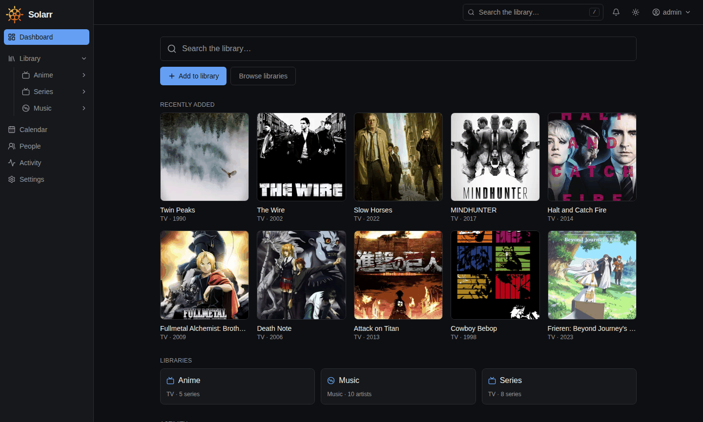
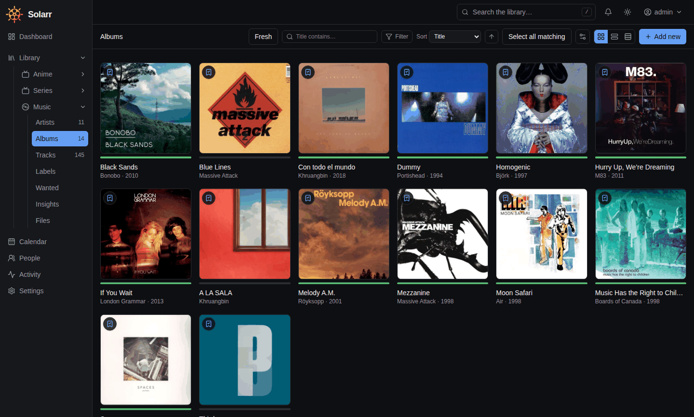
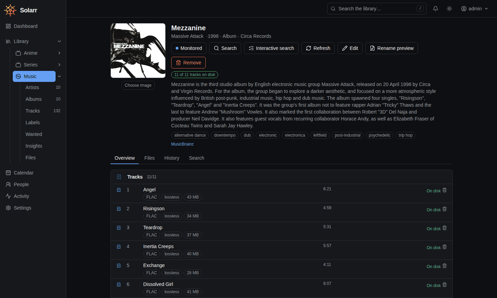
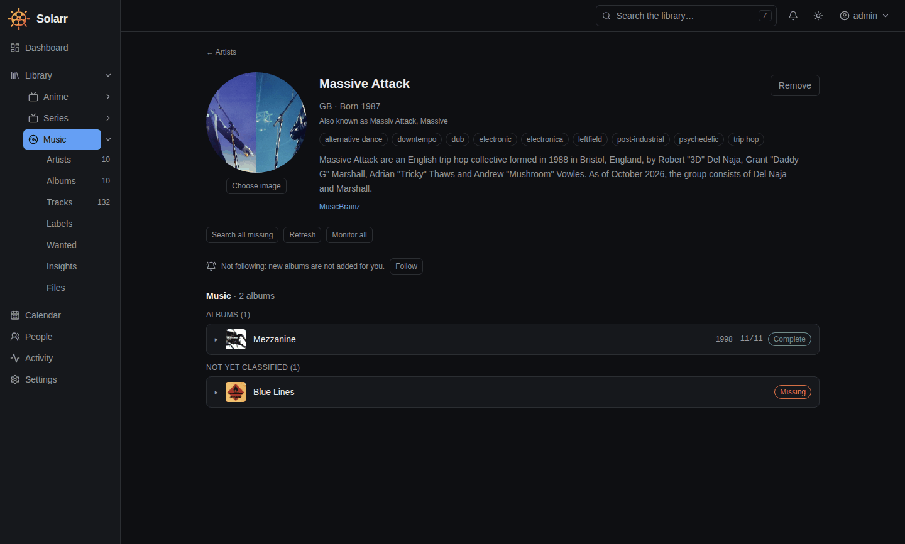
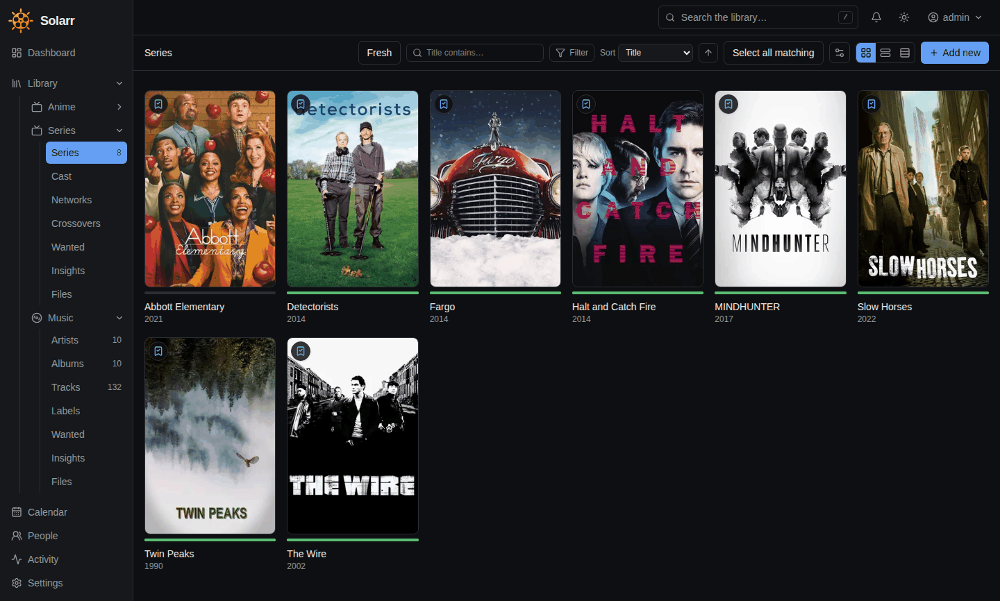
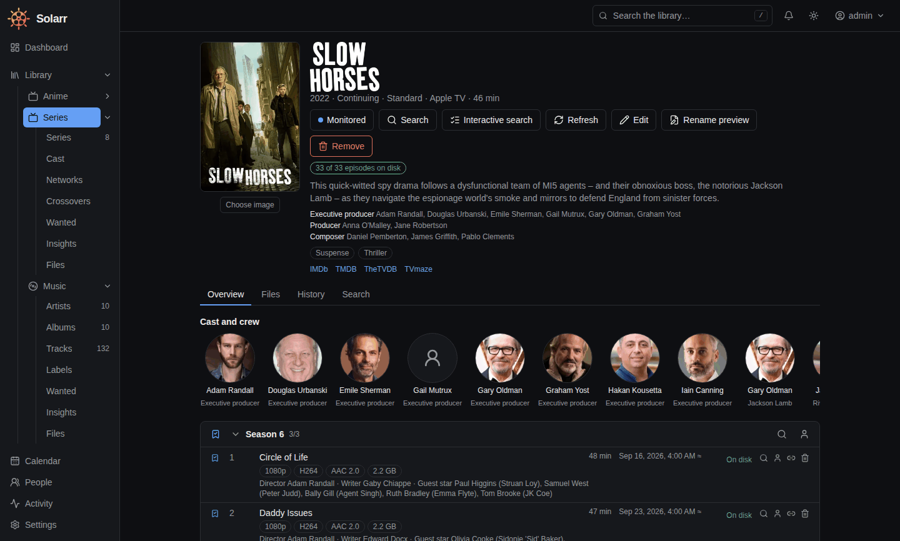
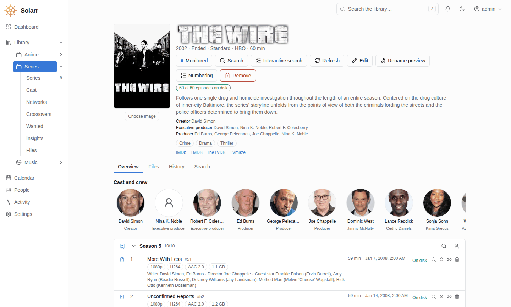
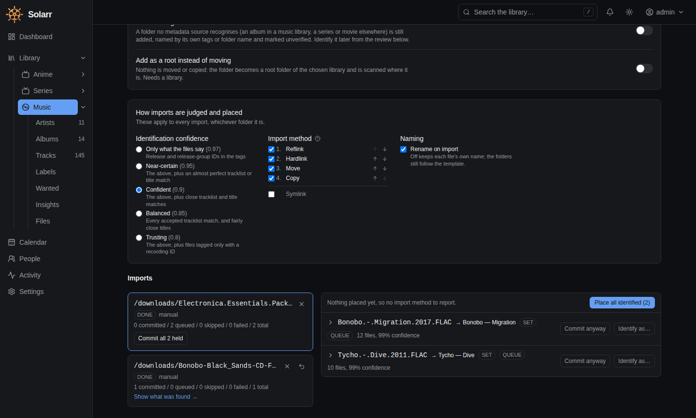
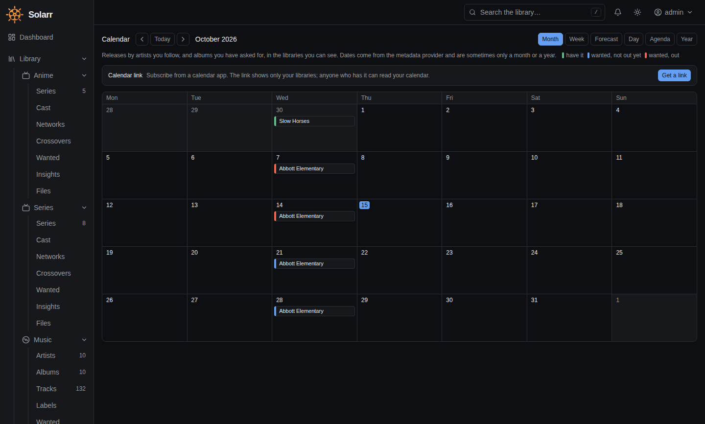
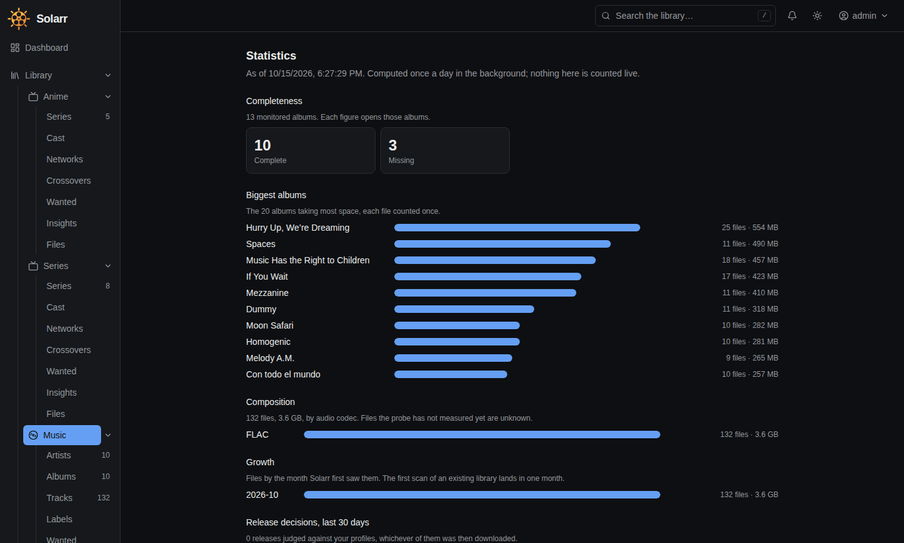

<p align="center"></p>

<h1 align="center">Solarr</h1>

<p align="center"><b>Your media library, managed properly.</b><br>
One self-hosted app that finds out what you have, what's missing and what could be better, then goes and gets it.<br>
Music (the Lidarr replacement) and TV (the Sonarr replacement) work today; movies are next.</p>

<p align="center"></p>

> **Under heavy development.** Not every expected feature is there yet, and the interface and the
> **database schema can still change** between versions. Expect rough edges, and don't point it at the
> only copy of anything you care about. See [What works today](#what-works-today) and
> [Not there yet](#not-there-yet).

---

## At a glance

- **One app, many libraries.** Music, TV and anime side by side, each library with its own folders,
  quality, naming and users. People are shared: an actor who also makes records is one person.
- **It hunts.** A planner decides what to search for and when, inside a budget you set, plus RSS and
  upgrade hunting. You don't press *Search all*.
- **It recognises messy folders.** Any folder, any depth, packs and archives, with a preview before
  anything moves and a one-click undo.
- **The file is the evidence.** Quality is judged from what ffprobe measures, not from the release name.
- **Safe by default.** Everything removed goes to a recycle bin first; your download client's own items
  are never touched.
- **One small container.** A Go binary with SQLite inside. No database server, no message broker.

## Screenshots

| | |
|---|---|
| [](documentation/screenshots/music-albums.png) **Music library**: albums as a poster wall, with table and overview views, filters and bulk edit | [](documentation/screenshots/album.png) **An album**: tracks with the measured format and size of every file |
| [](documentation/screenshots/artist.png) **An artist**: biography, aliases, the albums you have and the ones still missing | [](documentation/screenshots/tv-series.png) **TV library**: series with how much of each is on disk |
| [](documentation/screenshots/tv-series-page.png) **A series**: cast and crew, seasons, and per episode the file's resolution, codec and size | [](documentation/screenshots/tv-series-page-light.png) **Light or dark**, following your system |
| [](documentation/screenshots/import-preview.png) **Import preview**: an untagged two-album pack, both albums recognised from their tracklists | [](documentation/screenshots/calendar.png) **Calendar**: what you have, what's wanted and out, and what isn't out yet |
| [](documentation/screenshots/statistics.png) **Insights**: completeness, the biggest albums, formats and growth | |

<sub>Screenshots are from a demo instance. Its files are silent or blank placeholders, which is why every
track is the same FLAC and every episode the same 1080p H.264.</sub>

---

## What makes it different

Lidarr and Sonarr are good at the tidy case: sorted folders, well-tagged files, one library each.
Solarr is built for the messy case, and for people who run big libraries across several disks for years.

### One app, many libraries

A **library** is a named collection with its own root folders, quality profile, naming template,
language preferences and users. One Solarr runs as many as you like: music, live recordings, TV,
anime, documentaries. That is what several Lidarr and Sonarr instances do today. Each library has its
own navigation (lists, Wanted, Insights, Files, Settings), and people (actors, artists, directors) are
shared between libraries.

### Hunting: it goes and finds things

A planner works out which wanted items may be searched and how urgently: new releases first, then the
rest, with a backoff that doubles from 6 hours to a week. A scheduled hunt then searches the most urgent
ones within an hourly budget you set. Alongside it:

- **RSS sync** grabs new releases the moment an indexer lists them.
- **Upgrade hunting** looks for better copies of what you own with a fifth of the budget, and only
  replaces a file when the new one *strictly* wins.
- **Free-space gating**: nothing is sent that would not fit, counting what is already downloading.
- **Failure memory**: failed or fake releases are blocklisted by release *and* by content hash, and the
  item goes back on the want list.
- **It explains itself**: an album's page says when it was last searched, when it will be again, or why
  it won't be (no indexer, no free space, not released yet).

### Better recognition

Point Solarr at **any folder, at any depth**: one album, a whole collection, a messy download
directory. It identifies by evidence, in order: embedded MusicBrainz IDs, **whole-tracklist matching**
(durations, positions, titles), per-file search, folder names and, optionally, **AcoustID audio
fingerprints** for files with no tags at all. On a real library of about 200,000 files, **99.9% were
identified** on the first scan.

You get a **preview first**, then commit, and you can **undo the whole import in one click**. Packs and
box sets (one download that becomes many correctly named albums) and archives (zip, rar, 7z, tar, read
in place and **never unpacked into your library**) just work. Music nothing recognises becomes a
visible *unverified* album instead of sitting in an import screen for ever. For TV, Sonarr's own
release-name parser handles episodes, season packs, daily shows, anime absolute numbering and
multi-episode files.

### TV the way Sonarr does it, and a bit more

Sonarr's add dialog, monitor options, naming tokens, Wanted and Cutoff unmet, series types and season
folders, plus:

- **Several metadata sources**: Skyhook, TVmaze, TMDB (cast, crew and guest stars), TheTVDB and AniList.
- **Other orderings**: number a series by TheTVDB's DVD, absolute or alternate order, previewed first.
- **Air times**: an episode counts as out only once it has aired in its own time zone, with a grace
  period you set; seasons that haven't started say *Not out yet*.
- **Crossovers**: events across series in watch order, and one broadcast listed under two series held
  once and linked into both folders.
- **Jellyfin and Kodi files** (optional): `tvshow.nfo`, season and episode nfo files with the provider
  IDs, and the series' poster, fanart, banner and logo, written only where none exists.

### Libraries that span many disks

A library can have any number of root folders. An artist or series stays on one disk, new content goes
where there's room, and **retiring a disk is one button**: Solarr previews the move, checks the space
and drains it. A folder can be read-only, or declared offline for good, without anything on it being
treated as missing and re-downloaded. Every move is one engine: copy, verify, repoint, then delete.

### One copy of the same file

Two libraries (or two series) that want the same file share **one copy**. Solarr finds identical files
and links them with a **reflink, else a hardlink**, after showing you a preview. A separate report lists
likely duplicates by metadata (the same track on different albums) and recommends the copy closer to
your target quality. Links only work within one filesystem: across disks, an episode shared by two
series becomes a second copy or a symlink, your choice.

### Quality that means it

The **file is the evidence, not the release name.** Solarr measures what it downloaded with ffprobe, so
fake upgrades are refused, ties keep what you have, and a bigger number doesn't automatically win
(192 kHz does not beat a clean 48 kHz just for being larger). Profiles cover formats, codecs, bit depth,
resolution, HDR, audio and subtitle languages, and preferred release groups. **Remove and block**
recycles a bad file, blocks its exact bytes (renaming it can't sneak it back) and wants the item again.

### Safe by default

Nothing is deleted directly: it goes to a recycle bin first. A download is never removed before the
library copy is verified, a download client's queue is never touched beyond Solarr's own category, and
Solarr never takes ownership of your media.

### Easy to run, easy to use

Everything is done from the browser, and settings come in **normal / advanced / expert** levels so you
only see what you need. Several users can have different access to different libraries. Every decision
keeps its reasons, so "why did it do that?" is answered on the page, not in a log file.

### Move over without starting again

Solarr reads your existing **Lidarr**, **Sonarr** and **Prowlarr** setup (only ever *reads*, never
changes it). Naming defaults match Lidarr's and Sonarr's, so adopting an existing library proposes
**no renames**.

---

## What works today

| | |
|---|---|
| **Libraries** | Music and TV libraries, each with its own folders, quality, naming and users · poster, overview and table views · saved filters · bulk edit · tags · calendar with a subscribable link |
| **Music** | Artists, albums and editions (remasters, deluxe) · labels · artist aliases and merges · add an artist or album with monitoring · *Not released yet* until the release day · Navidrome-friendly tags and covers (optional) |
| **TV** | Series, seasons and episodes, anime and daily shows · Sonarr's add options and monitor modes · cast, crew, networks and follow · Wanted and Cutoff unmet · specials, absolute numbering and other orderings · air times and *Not out yet* · crossovers · Jellyfin/Kodi nfo and artwork (optional) |
| **Recognition** | Embedded IDs → tracklist matching → per-file search → folder names → optional AcoustID · music from BrainzMash, Lidarr's metadata server and MusicBrainz, tried in order · TV from Skyhook, TVmaze, TMDB, TheTVDB and AniList (TMDB wants your own free key) |
| **Finding** | Newznab/Torznab indexers (Prowlarr works as-is), searched in parallel · hunting, RSS, upgrade hunting · manual search with scores and rejection reasons · delay profile to prefer usenet or torrents |
| **Downloading** | **SABnzbd** and **qBittorrent** · queue, history, held releases, free-space protection · optional seeding limit per client (ratio or time) · failed releases blocklisted and searched again |
| **After download** | Import, rename by template (with preview), MusicBrainz IDs written into tags, subtitles brought along · reflink → hardlink → copy · upgrades replace files in place, never the other way round |
| **Running it** | Web UI · several users · notifications centre · statistics · encrypted secrets · automatic backups · scheduled tasks you can run on demand · YAML settings export |

## Architecture, and why it is fast

Solarr is **one static Go binary** with the web interface embedded. There is no .NET runtime, no
external database and no message broker.

**Four small SQLite databases instead of one large one**, each with a single writer:

| Database | Holds | Why separate |
|---|---|---|
| `settings.db` | Configuration and credentials (secrets encrypted) | Tiny, and **fully cached in memory**: reading a setting never touches disk |
| `library.db` | Everything that scales with your media: works, files, people, desired state | The big one. Reads never wait for writes |
| `jobs.db` | The work queue and event log | High churn, kept apart so a burst of background jobs never delays a library write |
| `statistics.db` | What was seen and done: download history, every release a search found and why it was taken or refused, figures over time | Append-mostly. The library stays correct with it empty, so it can grow or be pruned freely |

A cache directory holds artwork and metadata responses and can be deleted at any time. Databases are
backed up automatically and before every migration, and they must live on local storage.

Why this is quick compared with the \*Arrs:

- **Reads and writes don't block each other.** SQLite runs in WAL mode with a pool of readers and one
  writer behind a priority queue, so an edit you make in the UI jumps ahead of a bulk scan. Transactions
  stay under about 50 ms and bulk work is done in 200-row chunks; a CI test fails if one doesn't.
- **Built for 500,000+ files.** Partial indexes, cursor pagination (page 1,000 costs the same as page 1),
  and counters kept up to date as things change, so a dashboard number is a lookup, never a `COUNT(*)`.
- **Work is planned, not scanned.** A desired-state planner reads the database and emits actions; it does
  no I/O. Only what changed is looked at again, so it never re-walks your whole library to find out
  what's missing.
- **Parallel where it helps.** Indexers are searched at once with a deadline, metadata providers each get
  their own rate-limit bucket, and scans, probes and moves run in separate worker pools.
- **Measured, not claimed.** Speed targets are enforced as tests (`make bench`). See
  [database layout](documentation/database-layout.md) and [benchmarks](documentation/benchmarks.md).

## Performance

Numbers measured on the developer's machine, not guarantees.

**A real library, first scan.** About 200,000 audio files (16,000 folders, 700+ artists) on an NFS NAS,
scanned and identified from an empty database: **99.9% identified** (the rest go to a review queue), in
roughly **1 h 10 min to 3 h 35 min** depending on NAS load. The bottleneck is the NAS, not Solarr. An
interrupted scan resumes where it stopped.

**The database, on a synthetic 500,000-file library:**

| Operation | Typical (p50) | Worst case (p99) | Target |
|---|---|---|---|
| A page of the library list, filtered | 1.7 ms | 3.5 ms | 100 ms |
| Search-as-you-type over titles | n/a | 17 ms | 150 ms |
| Import 200 rows | 3.7 ms | 5.7 ms | 50 ms |
| A user's edit while a bulk write runs | 4.3 ms | 19 ms | 25 ms |

A TV library of about 1,000 series and 85,000 episodes (450,000 credits) answers every list in under
0.25 s.

## Not there yet

- **Movies** (the Radarr replacement) are designed, not built. Books, audiobooks and comics come later.
- **Duplicates across disks**: the duplicate finder links identical files on one filesystem only;
  matching the same audio across formats (Chromaprint) is not built.
- **Torrents** work end to end but have been used less than usenet; magnet-only indexer links are not
  tried.
- **RSS grabs** are tested but have not yet been seen catching a brand-new release live.
- **Notifications** are an in-app centre only; webhooks and per-service connectors come later.
- **Discovery** from your own library, subscriptions and external lists is partial; TV import lists
  (Trakt and others) are not built.
- **Radarr import** doesn't exist yet; Lidarr and Sonarr import do. Lidarr import is slow on very large
  libraries (hours).
- Not API-compatible with the \*Arrs, on purpose: their data model can't express editions, packs or
  files shared between libraries.
- The about-page source link and the container image are still private.

## Roadmap

1. **Finish and release the Lidarr and Sonarr replacements:** the remaining acceptance checks against
   live setups.
2. **Movies**, and import from Radarr.
3. **Coexistence:** run beside your existing \*Arrs and compare.
4. **Deduplication** across formats and disks.
5. **Discovery** from your own library first, then subscriptions and external lists.
6. Later: books, audiobooks, comics and other media types.

---

## Installation

Solarr ships as one Docker image with everything it needs (`ffprobe`, `fpcalc`, the tag writer).

> The image is at `ghcr.io/makearr/solarr`, currently **private**. If you can't pull it, build it
> yourself (below).

```yaml
# docker-compose.yml
services:
  solarr:
    image: ghcr.io/makearr/solarr:latest
    container_name: solarr
    restart: unless-stopped
    environment:
      PUID: 1000
      PGID: 1000
      TZ: Europe/Berlin
    ports:
      - "5454:5454"
    volumes:
      - ./config:/config        # settings, databases, backups: local disk, not NFS/SMB
      - /media:/media           # your library
      - /downloads:/downloads   # the same path your download client reports
```

Then open **http://localhost:5454**. There's also a ready-made [docker-compose.yml](docker-compose.yml).

Worth knowing:

- **`PUID`/`PGID`** set who Solarr runs as. It takes ownership of its own folders only, never your media.
  Don't set `user:`.
- **Keep `/config` on local storage.** SQLite doesn't work reliably over NFS/SMB.
- **Hardlinks need one filesystem.** Put the library and the completed-downloads folder on the same
  mount, or Solarr copies instead.
- Port 5454 can be changed with `SOLARR_SERVER_PORT` or on the Network screen.

### Build from source

Toolchains run in Docker; no local Go or Node is needed.

```sh
make verify        # format, vet, lint, tests
make web           # build the frontend
make image-local   # build a local image
```

---

## First steps

The full walk-through is the [user guide](documentation/user-guide.md). In short:

1. **Setup wizard:** create the administrator and your first library (a name, a type and a folder).
   Solarr scans it; covers, posters and photos arrive over the next few minutes.
2. **Connect an indexer and a download client** (SABnzbd or qBittorrent) under *Connections*, or take
   them from Prowlarr with *Connections → Arr*. The dashboard tells you what's still missing.
3. **Add music or series** with *Add new*, choosing what to monitor and whether to search straight away.
4. **Let it run.** Solarr checks RSS and searches for what's missing on a schedule.
5. **Follow along** in *Activity → Queue / History* and on each album's or series' page, which says when
   it was last searched, when it will be again, or why it won't be.

Settings are edited in the UI and can be exported as YAML. `config.yml` only holds bootstrap values; an
invalid one stops startup with every error listed at once.

---

## Solarr and the \*Arrs, side by side

| | Lidarr / Sonarr | Solarr |
|---|---|---|
| Media types | One per app | Music and TV in one app, movies planned |
| Libraries | One per instance | Any number per app, each with its own folders, quality and users |
| Searching | You press Search all | A planner hunts within a budget, plus RSS and upgrade hunting |
| Import | Sorted folders, one at a time | Any folder, any depth, previewed, fully revertible |
| Packs and box sets | Weak | One download → many albums or seasons |
| Archives | Extracted | Read in place |
| Unrecognised music | Stuck in the import screen | Visible as an unverified album |
| Fakes | Blocklist by release name | Blocks the exact bytes and wants the item again |
| Quality | Ordered format list | Gates, tiers and a score, judged from the real file; ties keep yours |
| Why did it do that? | A rejection string | Structured reasons kept per decision |
| Several disks | Root folders | Affinity, read-only / offline / draining, one-button drain |
| Same file twice | Two copies | One copy, linked (reflink or hardlink) after a preview |
| Crossover episodes | One series only | Held once, placed in both series |
| Deleting | Optional recycle bin | Always recycled first |
| Users | One login | Several, with per-library access |
| Settings | One long list | Normal / advanced / expert |
| Deployment | .NET app, one database | One Go binary, four small SQLite databases |
| Notifications | Many connectors | In-app centre only for now |
| **Maturity** | Years in production | Under heavy development |

---

## More

- **Documentation:** [documentation/](documentation/README.md): [user guide](documentation/user-guide.md),
  [music identification](documentation/music-identification.md), [TV internals](documentation/tv-internals.md),
  [naming](documentation/naming.md), [downloads](documentation/downloads.md),
  [file management](documentation/file-management.md), [container runtime](documentation/container-runtime.md).
- **Contributing:** Go, SQLite with sqlc, OpenAPI spec-first, React frontend. Start at
  [codebase-map.md](documentation/codebase-map.md) and [coding-standards.md](documentation/coding-standards.md);
  `make verify` must pass.
- **Third-party reuse:** [ATTRIBUTION.md](ATTRIBUTION.md). **History:** [CHANGELOG.md](CHANGELOG.md).

## Licence

[AGPL-3.0-or-later](LICENSE). Free to use, modify and self-host. If you run a modified version as a
service for others, you must make your changes available to them.
