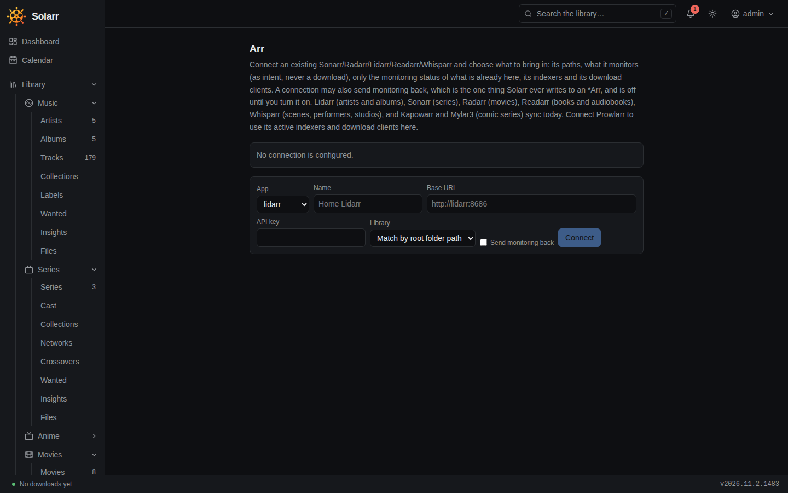

# Moving over from the \*Arrs

> **Level: 🟢 Beginner.** Bring your Lidarr, Sonarr, Radarr, Readarr and Whisparr along. They will not even notice.

## Feature set

- **Reads, never writes.** Solarr reads your Lidarr, Sonarr, Radarr, Readarr, Whisparr and Prowlarr setup: what they
  monitor, where it lives, their quality profiles, naming formats, indexers and download clients. Kapowarr and Mylar3
  (comics) work the same way.
- **Preview and mapping.** You see what would come across and choose what to bring and into which library.
- **No renames on adoption.** Solarr's naming defaults match the \*Arrs', so your existing folders stay as they are.
- **Companion mode.** Run Solarr beside your \*Arrs and, if you want, send monitoring back to them
  (`SOLARR_MODE=arr_companion`).
- **Familiar on arrival.** Add dialogs, monitor options, naming tokens, Wanted and *Cutoff unmet*, quality profiles.
- **Revertible.** An \*Arr import can be reverted like any other import.

## Benefits

- **Try it without burning bridges.** Run both side by side, mount your library read-only, decide later.
- **Keep your download stack.** SABnzbd, qBittorrent and Prowlarr stay exactly as they are.
- **One app replaces five or six**, plus Huntarr-style search tools, because hunting is built in.

## What you get beyond the \*Arrs

| | Lidarr / Sonarr / Radarr / Readarr / Whisparr | Solarr |
|---|---|---|
| Media types | One per app | All of them in one app (adult optional) |
| Libraries | One per instance | Any number, each with its own folders, quality, users and rating limit; mixed types allowed |
| Searching | You press *Search all* (Huntarr-style tools add a loop) | A planner hunts within a budget, plus RSS and upgrade hunting |
| Full download client | Grabs fail or wait | Held releases, sent in priority order as the client frees up |
| Import | Sorted folders, one at a time | Any folder, any depth, previewed, fully revertible |
| Packs and box sets | Weak | One download becomes many albums or seasons |
| Archives | Extracted | Read in place, never unpacked into the library |
| Unrecognised music | Stuck in the import screen | Visible as an unverified album |
| Fakes | Blocklist by release name | Blocks the exact bytes and wants the item again |
| Quality | Ordered format list | Gates, tiers and a score, judged from the real file; ties keep yours |
| Why did it do that? | A rejection string | Structured reasons kept per decision |
| Metadata | One source per app | Several per library, in an order you choose |
| Several disks | Root folders | Affinity, read-only / offline / draining, one-button drain |
| Same file twice | Two copies | One copy, linked after a preview |
| Crossover episodes | One series only | Held once, placed in both series |
| Deleting | Optional recycle bin | Always recycled first |
| Users | One login | Several, with per-library access |
| Preview player | None | In the browser, with transcoding |
| Settings | One long list | Normal / advanced / expert |
| Deployment | One .NET app per media type | One Go binary, four small SQLite databases |
| **Maturity** | Years in production | **Early alpha** |

## Technical details

- **REST, not database files.** Solarr talks to each \*Arr's own API with its API key; it never opens their SQLite
  databases, and only ever sends `GET` requests unless you switch on sending monitoring back.
- **Not API-compatible, on purpose.** The \*Arrs' data model cannot express editions, packs, or one file shared between
  libraries; emulating their API would mean inheriting those limits.
- **Readarr:** books and audiobooks arrive by Goodreads id with their monitoring and library mapping.
- **Measured:** about 4,000 films and 1,000 series came across in 29 to 38 minutes, paced by the metadata providers.

Further reading: [arr-import](../arr-import.md), [Solarr mode](../solarr-mode.md), [configuration export](../configuration-export.md).
