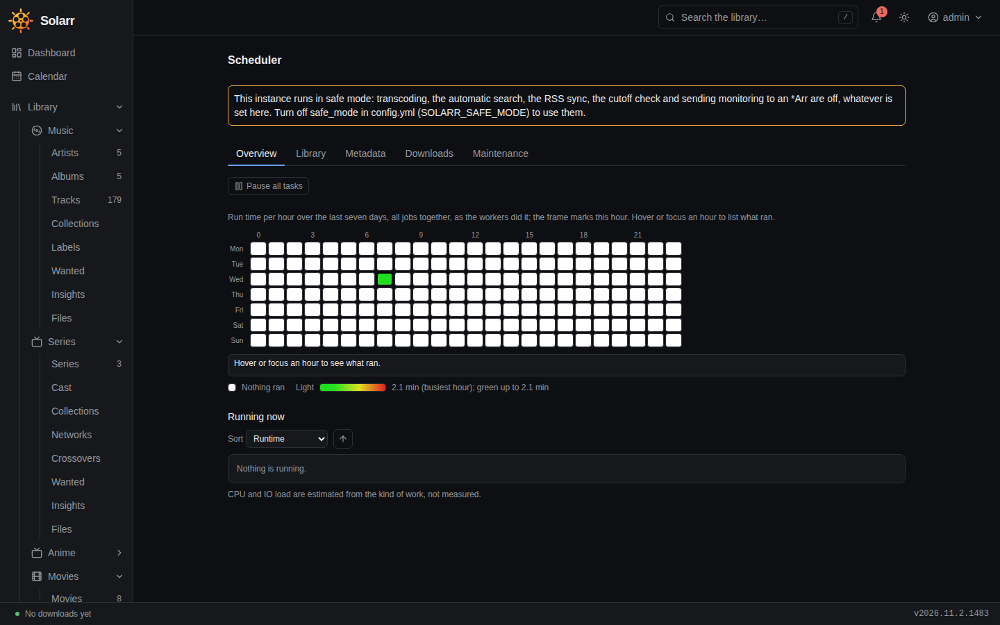
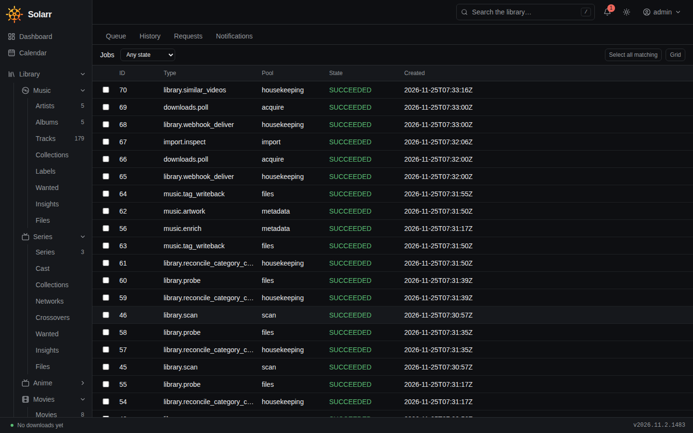
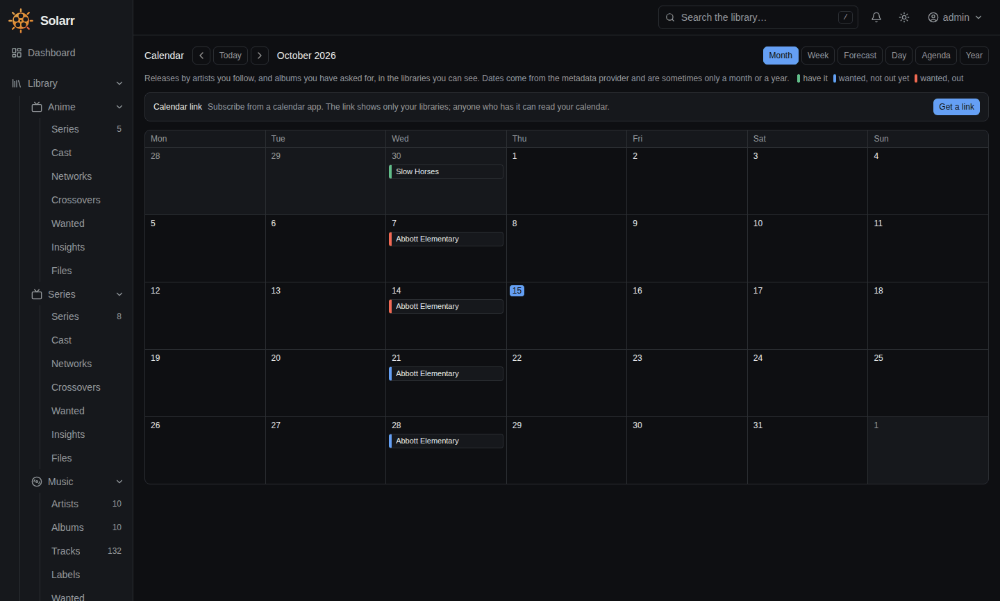
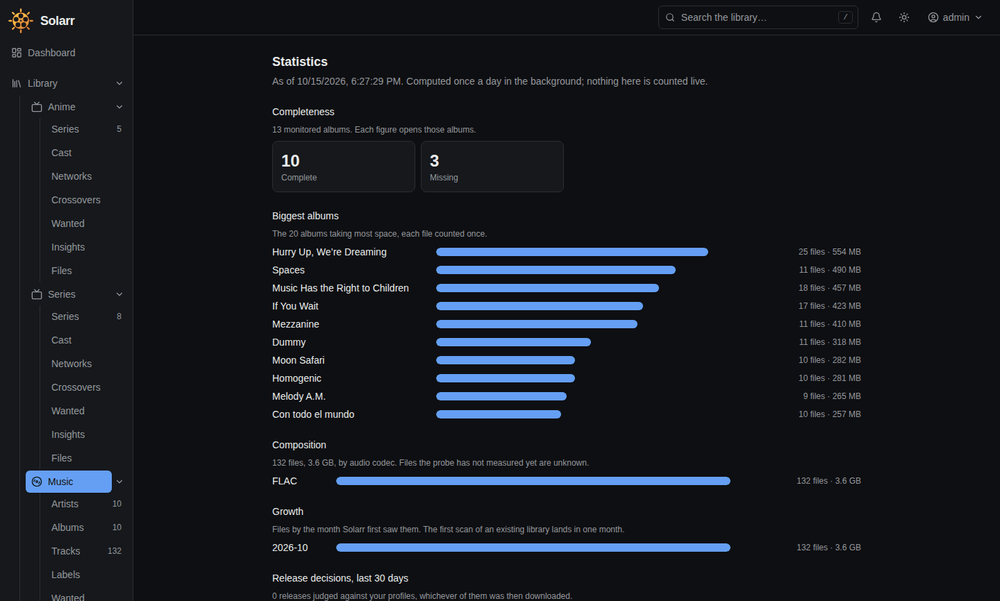

# Automation and activity

> **Level: 🟡 Advanced.** Everything Solarr does by itself is visible, explainable and pausable. No gremlins.

## Feature set

- **A scheduler you can see.** Every periodic task (scans, RSS sync, hunt, metadata refresh, artwork, backups, ...) is
  listed with its schedule, last run and next run; any of them can be **run now**, **paused** or resumed (or all at once).
- **Running now** with time left and estimated load, and a **heatmap** of real run time per hour over the last week.
- **Activity:** the download queue, history, requests, notifications and every job with its state.
- **Calendar** of what airs or releases, with a subscribable link (and a comic pull list).
- **Statistics** per library: completeness, biggest items, formats, growth, and a **health** page that names what is wrong: unreadable files (with ffprobe's message),
  missing tools, failing tasks, stale backups.
- **Backups** of the databases, and a settings snapshot on every change.

| | |
|---|---|
|  **Calendar**: what airs and releases, subscribable |  **Statistics** per library: completeness, biggest items, formats, growth |

## Benefits

- **Trust through transparency.** When Solarr is busy, you can see what with and for how long.
- **Control.** Moving house with the NAS? Pause everything with one button.
- **Problems surface on their own** instead of in a log you never read.

## Technical details

- **Every periodic action is registered**; nothing runs on a hidden timer.
- **A persistent job queue** in `jobs.db`: work is a row claimed with a lease; a reaper returns abandoned jobs and gives
  up on one that keeps killing its process; a hung-job watchdog catches the rest.
- **Separate worker pools** (search, acquire, import, metadata, scan, files, moves, housekeeping), so a long scan cannot
  starve a search.
- **Missed runs:** a task that missed its time while Solarr was down runs once on start, not once per missed slot.
- **Live updates** over server-sent events, coalesced on a 250 ms tick.

Further reading: [guide: automation](../guide/automation.md), [pausing tasks](../pausing-tasks.md), [startup checks](../startup-checks.md).
