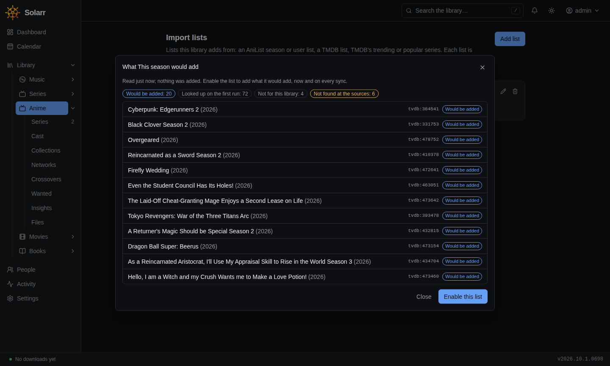

# Discover and import lists

> **Level: 🟡 Advanced.** "What should I watch next?", answered by the charts, filtered by your taste, approved by you.

## Feature set

- **Discover:** a poster wall per library of works you do not hold yet (or hold but do not monitor), from the charts of
  its sources: trending, highest rated, upcoming, classics, and "alike what you hold most of".
- **Add**, **Not interested** (with undo) and a **Hidden** view to restore what you dismissed.
- **Automatic adding (optional):** after each refresh a library adds recommendations that pass its rating and vote
  floors, up to a daily limit, never one it added before. You see a preview when you switch it on.
- **Import lists** for TV and more (an AniList season, a TMDB list, ...), previewed before you enable them.
- **Collections:** the missing members of a collection you hold one of.
- **Request-only accounts** see *Request* instead of *Add*.

| Library | Source |
|---|---|
| Movies, TV | TMDB (needs your TMDB key); anime reads AniList |
| Music | Last.fm (needs your Last.fm key) |
| Ebooks | Open Library |
| Audiobooks | Audible |
| Comics and manga | AniList manga charts |
| Adult | StashDB (needs its key) |

## Benefits

- **Find things you will actually like**, not just what is popular everywhere.
- **No surprise additions.** Everything is off until you switch it on, and automatic adding shows what it would add.

## Technical details

- **Off by default**: an instance switch (Settings → General), then per library (Settings → Discover) with list sizes,
  language, rating and vote floors, exclusions and a daily auto-add limit.
- **A list whose source cannot be read** (no key, source down) keeps its old items and says why.
- Discover settings are part of the [configuration export](../configuration-export.md).

Further reading: [discover](../discover.md), [import lists](../import-lists.md).
