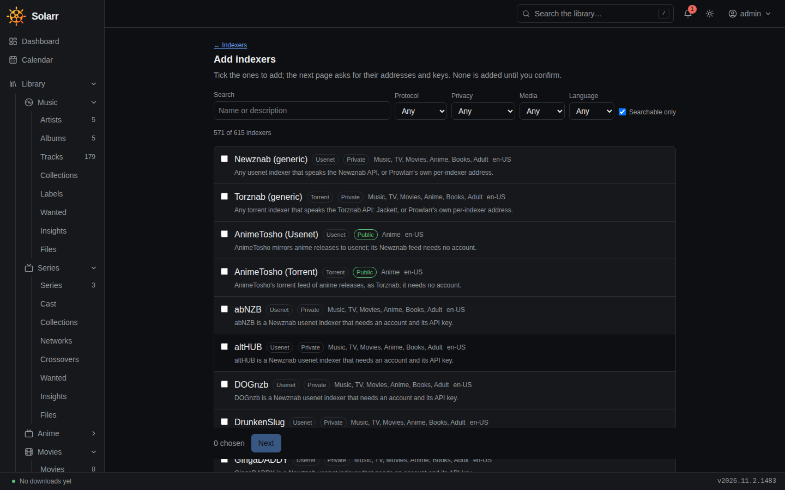

# Hunting and downloads

> **Level: 🟢 Beginner.** It looks for what you are missing, and for better copies of what you have, without hammering anyone.

## Feature set

- **A planner, not a "Search all" button.** It decides which wanted items may be searched and how urgently: new
  releases first, then the rest, with a backoff that doubles from 6 hours to a week.
- **An hourly budget you set.** The scheduled hunt searches the most urgent items inside it, so your indexers' API
  allowances survive the month.
- **RSS sync** grabs new releases as they appear.
- **Upgrade hunting** replaces a file only when the new one *strictly* wins (see [quality](quality.md)).
- **Held releases.** When the download client is full, releases wait in priority order instead of failing.
- **Free-space gating.** Downloads stop before your disk is full (50 GB or 2 % by default).
- **Fakes and failures** are blocklisted by release name *and* by content hash, and the item is wanted again.
- **Indexers your way.** Use Prowlarr (its indexers, proxies and clients sync hourly), any Newznab/Torznab indexer, or
  Solarr's own indexer engine with a catalogue of about 600 definitions, FlareSolverr and proxy support, indexer
  priority and per-indexer download client binding.
- **Download clients:** SABnzbd, NZBGet, qBittorrent, Transmission, Deluge, rTorrent, uTorrent, Flood, aria2, slskd and
  blackhole folders, plus your own as definition files.
- **"Why is it waiting?"** Every wanted item shows when it was last searched, what was found, why each release was
  rejected and when it is due again.

## Benefits

- **Complete libraries without babysitting.** No more Sunday-evening "Search all monitored" sessions.
- **Polite to your indexers.** A budget, stated API allowances respected, back-off on a limit answer, one sign-in shared
  by parallel searches. Indexer admins like that. You like keeping your account.
- **No silent failures.** A full client, a full disk, a dead torrent or a release the indexer stopped serving is a
  visible state with a reason, not a mystery.

## Technical details

- **The planner is a pure read** of library state that emits idempotent actions, each with an `action_key`. Running it
  twice does nothing twice, so it can run often and cheaply.
- **Jobs for correctness, events for display.** A search, grab or import is a row in the job queue with a lease; if
  Solarr dies mid-job, a reaper puts it back. Events are lossy and never used as a work queue.
- **Decisions are structured data.** Every rejection and every score component is stored as data (not a formatted
  string), so the interface can explain it and you can filter by it.
- **TV specifics:** daily series searched by air date, a season missing a few episodes searched episode by episode,
  several non-overlapping downloads of one season in parallel.
- **Solarr never reverts what you did in a download client**, and a download source is never deleted before the
  library copy is verified.
- **Safe mode** (`SOLARR_SAFE_MODE=true`) keeps the automatic search, RSS sync and cutoff check off without touching a
  setting: handy for a test instance.

Further reading: [downloads](../downloads.md) (held releases, ordering), [guide: connections](../guide/connections.md),
[guide: automation](../guide/automation.md), [safe mode](../safe-mode.md), [Solarr mode](../solarr-mode.md),
[pausing tasks](../pausing-tasks.md).
