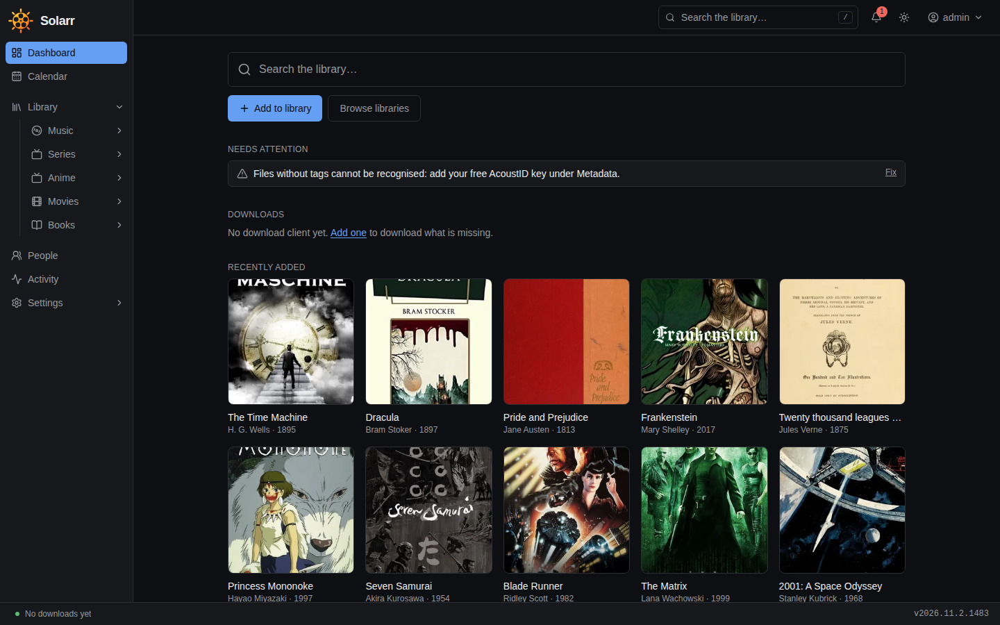
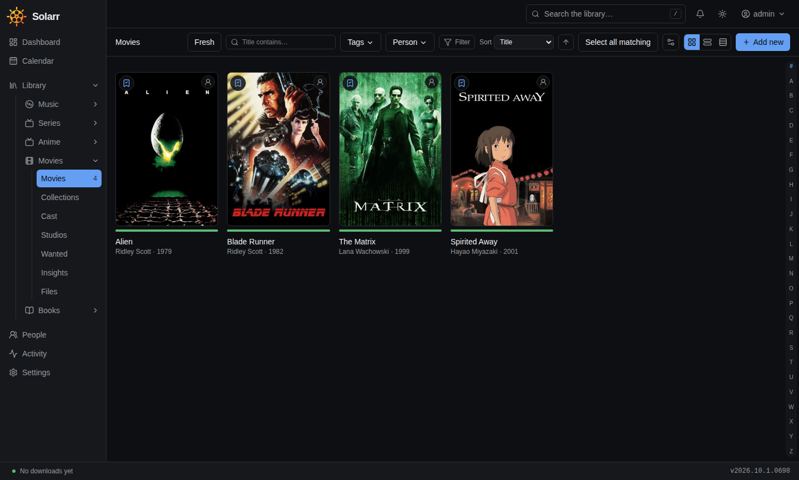
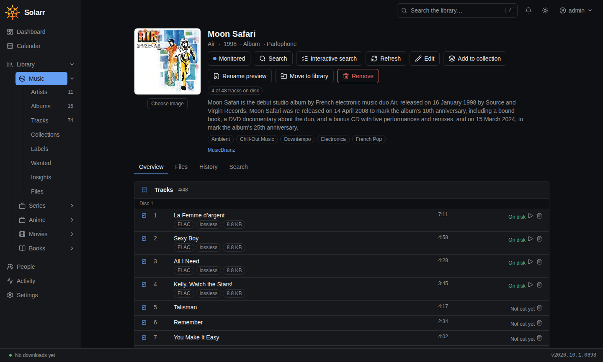
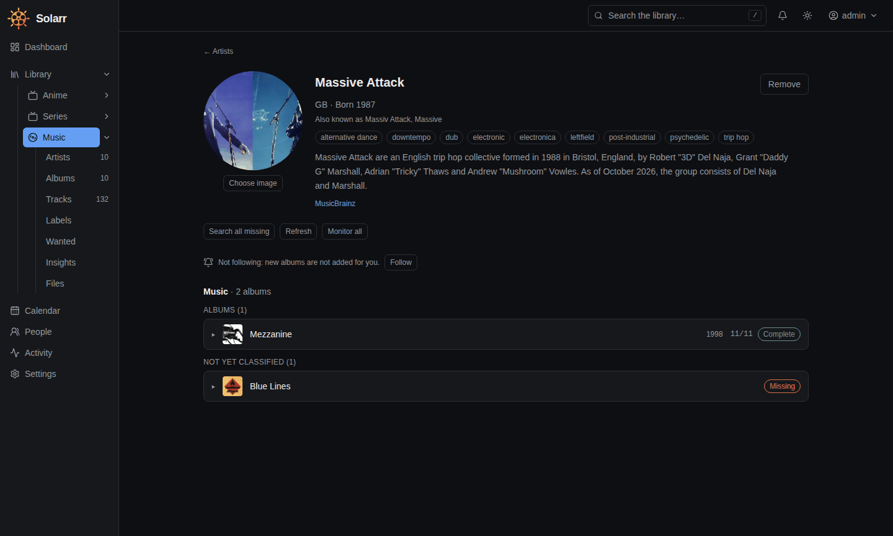
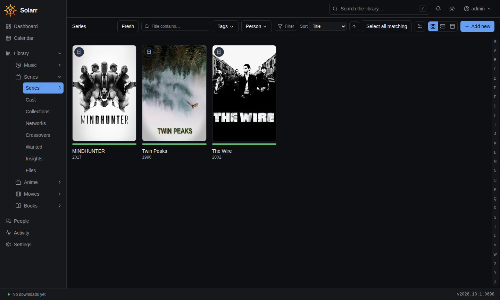
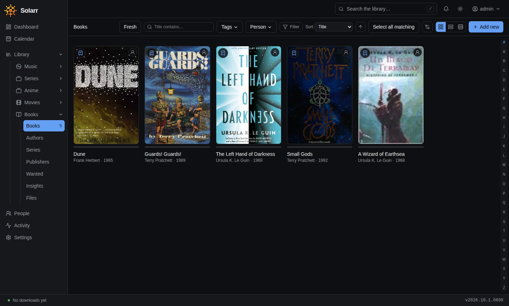

# Libraries and media types

> **Level: 🟢 Beginner.** One app for every kind of media, and as many libraries as you have opinions.

## Feature set

A **library** is a set of folders plus the rules for them: which media type it holds, its quality wishes, its naming,
its metadata providers and who may see it. You can have any number of them.

| Media type | Library kinds | What it knows about |
|---|---|---|
| **Music** | Music | Artists, albums, editions (the 2011 remaster is not the 1997 original), tracks, labels |
| **TV** | Series, anime, documentary, reality, kids, daily | Series, seasons, episodes, networks, cast; anime with absolute numbering and anime ids |
| **Movies** | Movies, anime, documentary, kids | Films, editions (director's cut, extended), collections and franchises |
| **Books** | General, kids | Authors, series (including the books a series still lacks), covers |
| **Audiobooks** | General, kids | Like books, plus narrators |
| **Comics** | Comics, manga, adult comics, hentai | Series, issues, volumes, chapters, annuals, collected editions, a pull list |
| **Adult** (off by default) | Scenes, movies | Scenes, films, studios, performers |

- **Mixed libraries.** A "Kids" library can hold series *and* films side by side. See [mixed libraries](../mixed-libraries.md).
- **One file, two libraries.** A concert film can live in "Movies" and "Music videos" without being stored twice.
- **Per-library everything.** Folders, quality target, naming, metadata order, import lists, rating limit, users.
- **Familiar views.** Every list has a poster wall, a table and an overview, with filters, sorting, saved views,
  bulk edit (select by filter, preview, apply) and a heart for favourites.
- **Work pages** that answer "what do I have and what is missing": editions, seasons, episodes, the file on disk with its
  measured quality, cast and crew, collections and history.

| | |
|---|---|
|  **An album**: every track, what is on disk and what is still missing |  **An artist**: albums complete or missing, and Follow for new releases |
|  **A TV library** as a poster wall |  **Books**: authors, series and covers |

## Benefits

- **One program to learn, update and back up** instead of one per media type.
- **Split however your household thinks.** Kids' stuff, the partner's audiobooks, your questionable 90s
  eurodance phase: separate libraries, separate rules, separate access.
- **Nothing is forced into the wrong shape.** Anime is not "TV with weird numbers", a box set is not one giant
  album, and a book series knows which volume you are missing.
- **It stays fast when the library is huge.** A filtered page of a 500,000-file library comes back in a few
  milliseconds; page 1,000 costs the same as page 1.

## Technical details

- **One generic core.** Works, editions and files (`Work → Edition → File`) plus candidates are the same tables for
  every media type; what differs per type (parser, providers, naming tokens, facets) is declared at named extension
  points. Adding a media type does not fork the engine.
- **Internal ids are never provider ids.** A work keeps its identity if a provider renumbers, merges or disappears.
- **Server-side lists.** The server filters, sorts and pages; the browser holds one page and virtualises long lists.
  View state (filters, sort, tab) lives in the address bar, so every view is a link and survives a reload.
- **Counts are counters**, kept up to date on write, never a live `COUNT(*)` over half a million rows.
- **Bulk selection is a query** (`{filters, excludedIDs}`) with a preview of what it touches, so "select all 40,000"
  does not ship 40,000 ids to the browser.

Further reading: [guide: libraries](../guide/libraries.md), [mixed libraries](../mixed-libraries.md),
[library suggestions](../library-suggestions.md), [rating limit](../rating-limit.md), [tags](../tags.md),
[books](../books.md), [comics](../comics.md), [adult](../adult.md), [web interface](../web-interface.md).
