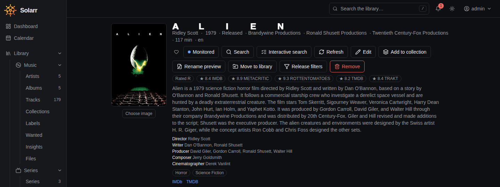
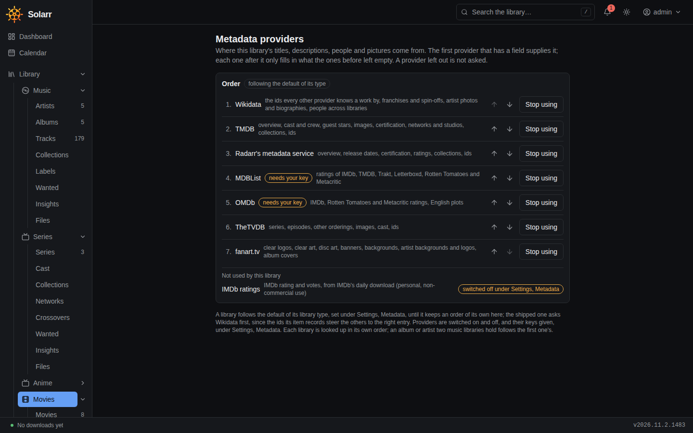

# Metadata

> **Level: 🟢 Beginner.** Covers, posters, cast, ratings and blurbs, from more than one source, without you lifting a finger.

## Feature set

- **Several providers per library, in an order you choose.** The first provider that knows a field supplies it; later
  ones only fill what is still empty. Any provider can be switched off.
- **Works out of the box** with free, keyless sources. Add your own keys (TMDB, fanart.tv, OMDb, ...) for more.
- **Ratings from everywhere**: TMDB, IMDb, Rotten Tomatoes, Metacritic, MusicBrainz, Deezer,
  ListenBrainz, AniList and more, each shown as its own chip.
- **Picture pickers** offering every provider's covers, posters, logos, banners and backgrounds, including your own
  media server's.
- **Collections and franchises** from TMDB, AniList and Wikidata (which knows franchises no single provider holds).
- **Metadata language**: one setting makes TMDB, Skyhook and Wikipedia answer in your language.
- **Your own providers** as YAML definition files, for the niche source nobody else supports.

| Library | Providers |
|---|---|
| **Music** | MusicBrainz, BrainzMash (a fast MusicBrainz mirror), Lidarr's metadata service, Cover Art Archive, TheAudioDB, Wikidata and Wikipedia, AcoustID, Deezer, ListenBrainz, Last.fm, Discogs, LRCLIB lyrics |
| **TV and anime** | Skyhook (Sonarr's service), TheTVDB, TMDB, TVmaze, AniList, MyAnimeList, AniDB, OMDb, fanart.tv, Wikidata |
| **Movies** | TMDB, Radarr's metadata service, Wikidata, TheTVDB, MDBList, OMDb, IMDb datasets, fanart.tv |
| **Books and audiobooks** | Open Library, Google Books, Hardcover, BookBrainz, FantLab, iTunes, Audible with Audnexus, Internet Archive |
| **Comics and manga** | ComicVine, Metron, Grand Comics Database, MangaUpdates, MangaDex, AniList |
| **Adult** | StashDB and other stash-box servers, ThePornDB, Whisparr's metadata |
| **Local** | Jellyfin, Audiobookshelf, Calibre, Kavita, Stash: ranked last, only filling what the online sources lack |

## Benefits

- **No single point of failure.** One provider down or missing a title? The next one answers.
- **Better pages than any one source gives.** TMDB's cast, TheTVDB's episode orderings, Wikidata's franchises and
  OMDb's IMDb score on the same page.
- **Your library is usable straight after the scan.** Artwork fills in over the next minutes, in the background.

## Technical details

- **Wikidata ties providers together**: it knows the id every other provider uses for a work, so it bridges them.
- **Per-provider rate limits** at each provider's published pace, adjustable live, so a slow provider never holds up a
  fast one. Requests run in parallel across providers, with a shared response cache.
- **Bulk reads where possible**: Wikidata is asked about 40 works per query. Importing about 4,000 films went from a
  projected 33 hours to 29 minutes once per-film lookups became bulk reads.
- **Outages serve the stored answer.** A refresh while a provider fails is skipped and retried, instead of replacing
  good data with a fallback's thinner answer. A refresh that finds nothing changed writes nothing.
- **Every outbound call** goes through one HTTP client with pacing, circuit breakers and an SSRF guard.

Further reading: [metadata providers](../metadata-providers.md) (field by field), [TV providers benchmark](../tv-providers-benchmark.md),
[provider definitions](../provider-definitions.md), [outbound requests](../outbound-requests.md).
