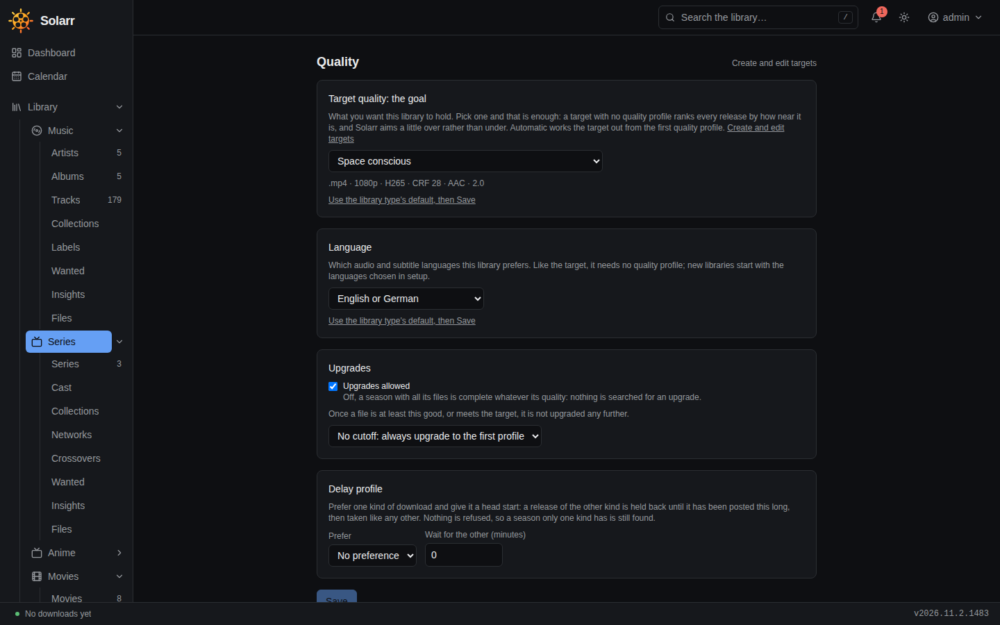

# Quality

> **Level: 🟡 Advanced.** The file is the evidence. The release name is just a rumour.

## Feature set

- **A target per library** ("Space conscious", "Lossless preferred", your own): what you want the library to hold. Pick one
  and you are done; quality profiles are there when you want finer control.
- **Profiles** cover formats, codecs, bit depth and sample rate, resolution, HDR, audio and subtitle languages, preferred
  and avoided release groups, a freeleech bonus, and a cutoff after which nothing is upgraded.
- **Measured, not claimed.** After a download, Solarr measures the file with ffprobe. A "1080p" that is really 720p is
  treated as 720p.
- **Upgrades must strictly win.** Ties keep what you have.
- **Bigger is not automatically better.** 192 kHz does not beat a clean 48 kHz just for being larger.
- **Remove and block.** Recycles a bad file, blocks its exact bytes, and wants the item again.
- **Delay profiles** give usenet or torrent a head start before the other is considered.
- **Cutoff unmet** and **Wanted** lists, as you know them from the \*Arrs.

## Benefits

- **No upgrade loops.** The classic "replaced my file with the same file, five times" cannot happen when ties keep the incumbent.
- **Fake upgrades are refused**, because the measurement wins over the name.
- **You can see why.** Every accepted or rejected release shows its score components.

## Technical details

- **Three stages:** hard gates (must-haves and never-haves) → tiers (ordered acceptable qualities) → an additive score
  inside a tier. A release must pass every gate, reach a better tier or a strictly higher score in the same tier.
- **Probe facts beat release-name claims.** When both exist and disagree, the probe wins.
- **The decision is one structured value** (`Decision`) with every component kept per release, retained in full for
  90 days by default (`SOLARR_RETENTION_DECISIONS_FULL`).
- **Content-hash blocklist:** blocking hashes the bytes, so the same bad file under another release name is refused.
- **A quality-change preview** counts what would fall under or over the cutoff before you save a new target.

Further reading: [library quality](../library-quality.md) (profiles, cutoff, target, what "fits" means),
[import rules](../import-rules.md), [guide: TV quality](../guide/tv.md).
