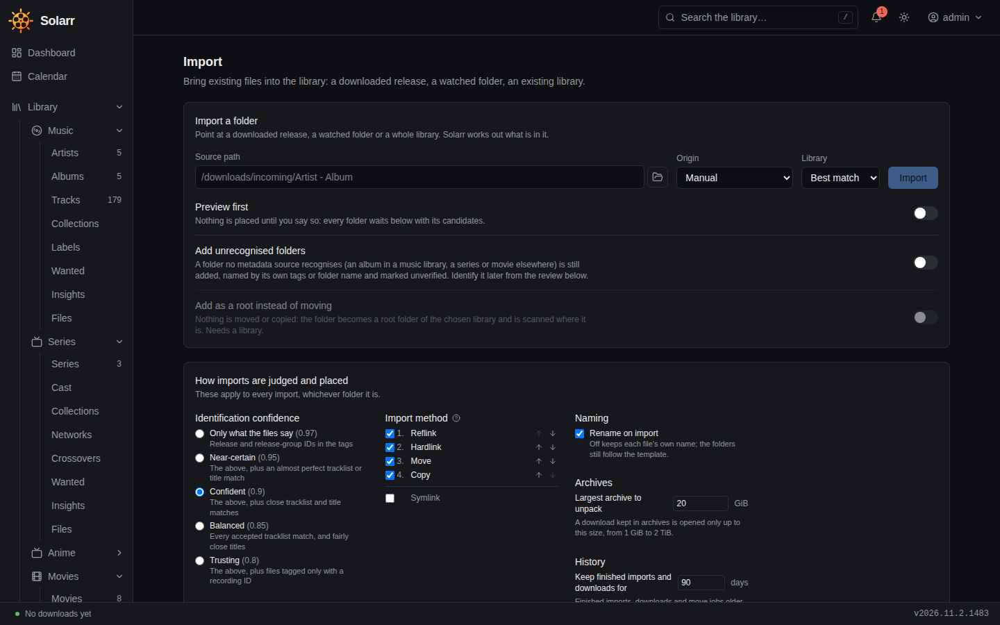
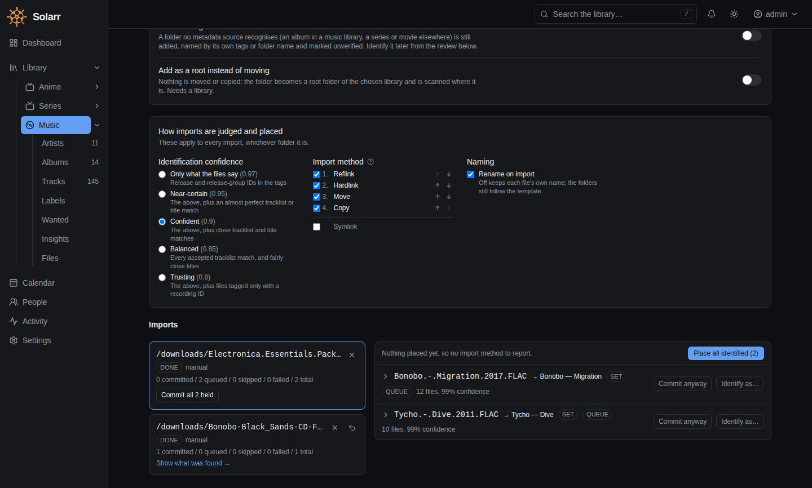

# Recognition and import

> **Level: 🟢 Beginner.** Your folders are a mess. That is fine. That is the point.

## Feature set

- **Any folder, any depth.** Solarr inspects; it is never told what a folder holds. A download folder, a ten-year-old
  "Music (sorted, really)" tree or an existing tidy library all work.
- **Evidence in order of trust.** Embedded ids (MusicBrainz, ISBN, ASIN, provider ids in folder names), **whole-tracklist
  matching** (durations, positions, titles), tags, per-file search, folder and file names, and optionally
  **AcoustID audio fingerprints** for files with no tags at all.
- **Preview first.** You see what each folder would become, with the confidence and the reasons, before anything moves.
- **Undo the whole import** in one click. Every import is revertible.
- **Unrecognised is visible, not lost.** Music nothing recognises becomes an *unverified* album you can fix later;
  other files land in *Unidentified* with the attempts that were made.
- **Awkward shapes handled.** Packs and box sets that become many albums or seasons, multi-disc folders, Blu-ray and
  DVD folders (held for review as one unit), archives read in place, Calibre `metadata.opf` and EPUB metadata, comic
  archives with `ComicInfo.xml`, hidden pregap tracks, crossover episodes.
- **Your media server as a hint.** Ids your Jellyfin, Audiobookshelf or Calibre already hold for a folder are used
  before any title search.

## Benefits

- **You do not have to clean up first.** Cleaning up is Solarr's job.
- **Fewer wrong matches.** A 2-track single and a 14-track deluxe edition share a title, not a tracklist; matching the
  whole tracklist tells them apart.
- **No fear of the big button.** Preview, then commit, then undo if you change your mind.
- **Measured, not promised:** on a real library of about 200,000 audio files, **99.9 % were identified** on the first scan.

## Technical details

- **One commit threshold (0.90).** Above it a unit is placed; below it, it waits for review. You can make the
  threshold stricter or looser per import (*Identification confidence* on the Import page).
- **Import concurrency is 1, on purpose.** Imports run one at a time through the single library writer, so the
  interface stays responsive during a 200,000-file import. Steady rather than fast.
- **Never scans the whole download directory.** An import looks at the folder it was given (or the one a download
  client reported), nothing else.
- **Linking, not copying, where the filesystem allows:** reflink, then hardlink, then copy (probed per path pair), so a
  download you keep seeding and the library file take the space once. Never symlinks.
- **A failing step takes back what it placed.** Imports are journalled per unit.
- **Archives** (zip, rar, 7z) are read in place up to a size you set; nothing is unpacked into the library.

Further reading: [guide: importing](../guide/importing.md), [import rules](../import-rules.md),
[music identification](../music-identification.md) (the passes and what was measured), [TV internals](../tv-internals.md).
