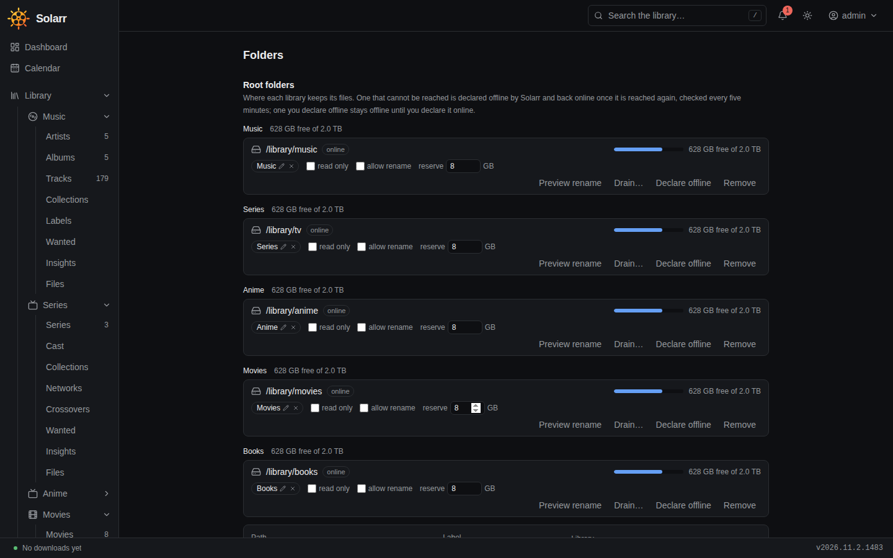
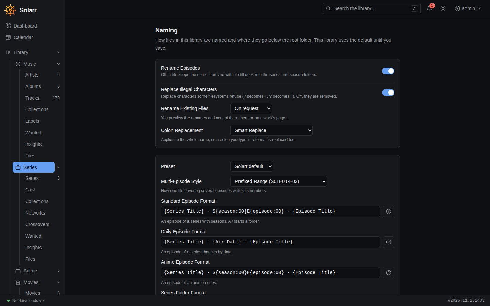
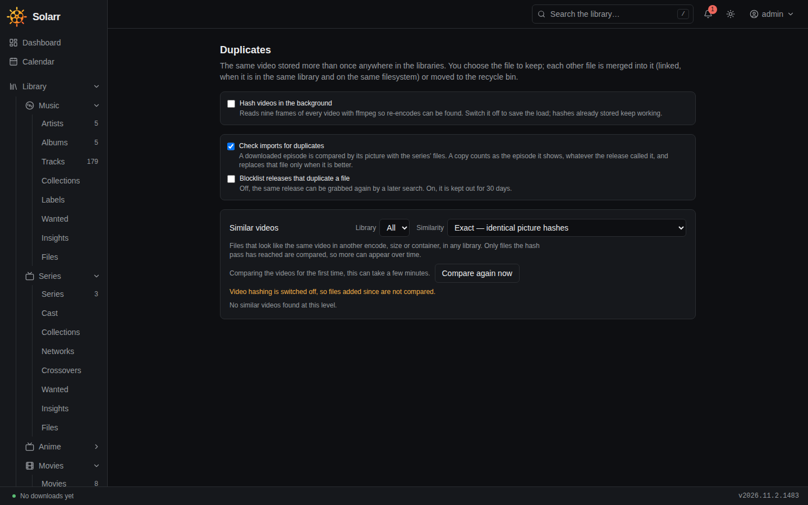

# Files, folders and storage

> **Level: 🟡 Advanced.** Tidy names, many disks, nothing deleted behind your back, and every byte stored once.

## Feature set

**Naming**
- **Sonarr/Radarr/Lidarr-style naming tokens** and presets (Solarr default, Plex and Jellyfin style), so adopting an
  existing library proposes **no renames**.
- **Rename preview** before anything moves, per work or for a whole library.

**Storage**
- **Any number of root folders per library.** An artist or series stays on one disk; new content goes where there is room.
- **Read-only, offline and draining roots.** Declare a disk offline and nothing on it is treated as missing or
  downloaded again. **Draining** a disk is one button: preview, space check, move, done; retire the disk.
- **A recycle bin, always.** Nothing is deleted directly.

**Duplicates**
- **One copy, many places.** Identical copies of a file become one copy (reflink or hardlink) after a preview; an episode
  listed under two series is linked into both folders.
- **Same file, different name.** *Remove and block* blocks the exact bytes.
- **Similar videos.** The same footage in another encode, resolution, frame rate, container or with black bars is found
  by perceptual hashes, at five similarity levels. Keep one copy; merge or recycle the rest. Off by default (it costs CPU).
- **Music duplicates** by audio fingerprint.

## Benefits

- **Your media server sees one clean, consistent structure.**
- **Retiring or adding a disk is boring.** As it should be.
- **Disk space back** without the anxiety of deleting the wrong copy.
- **Recoverable mistakes.** The recycle bin catches everything; a download source is never deleted before the library
  copy is verified.

## Technical details

- **One move engine** for every move, rename and drain: copy, verify, repoint, then unlink.
- **Links, never symlinks:** reflink → hardlink → copy, with the capability probed per path pair, because ZFS datasets,
  bind mounts and NFS all have opinions.
- **ZFS and NFS:** designed for ZFS, tested on NFS. File watching (inotify) is only an accelerator; stale handles
  (`ESTALE`) are retried. The databases belong on local disk.
- **Disk-aware I/O.** Probing, tag write-back, moves, linking and imports wait their turn per disk; idle disks are left alone.
- **Video hashing:** frames at nine moments plus the duration, about 1.5 s of one CPU core per 1080p video; compared
  nightly and stored, so the report opens at once.

Further reading: [naming](../naming.md), [file management](../file-management.md), [guide: storage](../guide/storage.md),
[duplicate videos](../duplicate-videos.md), [disk I/O](../disk-io.md).
