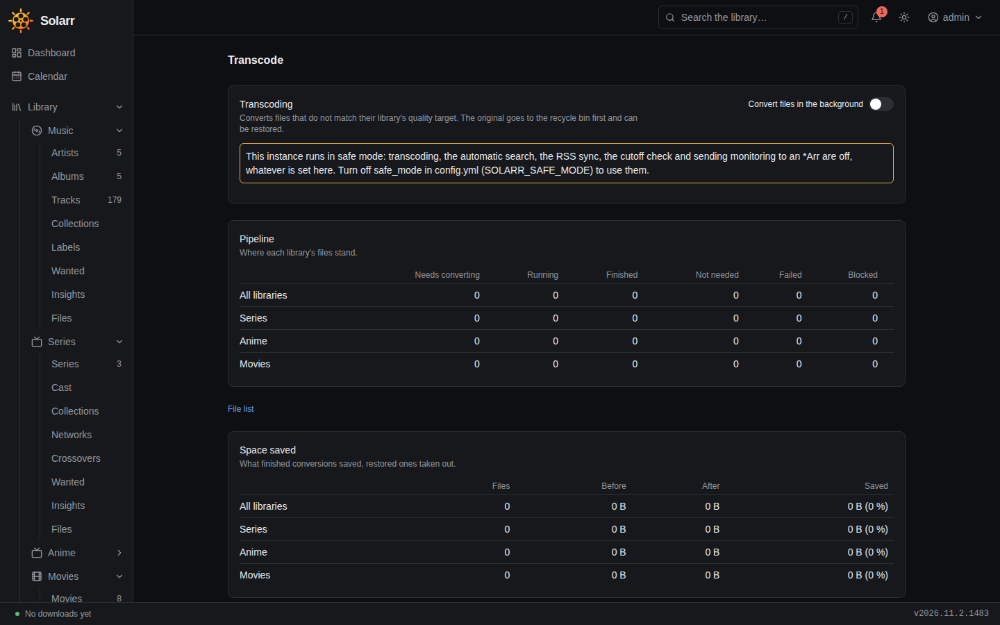

# Transcoding

> **Level: 🟡 Advanced.** Shrink a library to its target quality while you sleep, and change your mind tomorrow.

## Feature set

- **Converts files already in a library** to the library's target quality: audio, video, and comics (cbr, cb7 and cbt
  become cbz, pages re-encoded to the target's image format).
- **Off by default.** One master switch, then per library.
- **A setup editor per target:** engine (unavailable ones greyed out, with the reason), quality or bitrate, skip rules,
  streams to keep, filters, result checks, a second pass.
- **A file list** with every judged file, its state and the reasons in words; retry a selection with other settings.
- **Originals kept and restorable** for a retention period you choose.
- **Space saved**, per library, in bytes and percent.

## Benefits

- **Reclaim disk space** without hand-running ffmpeg scripts at 2 a.m.
- **Consistent libraries** that play everywhere without on-the-fly conversion.
- **No risk of an unwatchable result:** every result is checked, and the original is one click away.

## Technical details

- **Pipeline:** analyse (judge every file from stored probe facts, reading no disk) → dispatch → convert → check → replace.
- **Lowest priority:** `nice 19`, `ionice` idle, three lanes (`cpu`, `gpu`, `audio`) with their own limits, and a smaller
  set of limits while the [player](player.md) converts.
- **Graceful GPU fallback:** a GPU step that fails in the first 5 % hands the file to CPU decode, then to software.
- **Checks:** streams, duration, size against the original and the target's range. Too large? Down the setup's ladder
  (higher CRF, lower bitrate) for a few passes, then fail with a reason.
- **Replace is one transaction:** the original goes to the recycle bin (reason `transcoded`), the result takes its
  place, and the library gets the new size, hash and path at once.
- **Pausable:** pausing the `transcode` task in the scheduler interrupts running conversions without spending an attempt.

Further reading: [transcoding](../transcoding.md) (pipeline, lanes, originals and restore, the API), [library quality](../library-quality.md).
