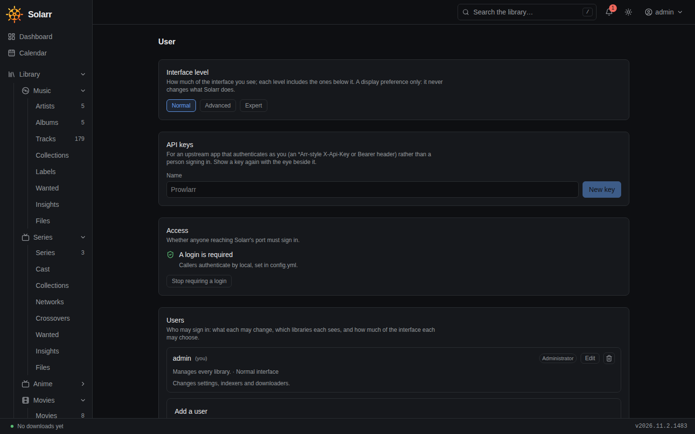

# Users and interface levels

> **Level: 🟢 Beginner.** The kids get the kids' library. You get the expert settings. Everybody is happy.

## Feature set

- **Several accounts**, each with a role: administrator, user, or read only.
- **Access per library:** no access, request, add, or manage. Requests wait for an administrator's approval
  (Activity → Requests) unless the account may add directly.
- **Hide items by tag** from an account, whatever its library access.
- **Per-user preferences:** views, filters, favourites and interface level are remembered per account.
- **Interface levels: normal, advanced, expert.** Each level shows more settings; normal hides everything you do not need
  to run a library.
- **API keys** for tools that talk to Solarr, and a **proxy-header mode** for single sign-on set-ups (Authelia, Authentik, ...).

## Benefits

- **Share the server without sharing the chaos.** Housemates can request, not delete.
- **Approachable for beginners, deep for tinkerers**, in the same app.
- **Safe defaults:** a fresh install claimed from a public address needs the setup code from the log.

## Technical details

- **No access is a 404, never a 403**: an account cannot even learn that a library exists.
- **Access is enforced everywhere**: lists, work pages, files, covers, playback, search results, the live event stream.
- **Auth modes:** `local` (default), `proxy` (trusted header from listed proxy addresses only), `apikey_only`, `none`.
- **Passwords** of 8+ characters, asked twice; secrets are encrypted at rest and never returned by the API.

Further reading: [users and access](../users-and-access.md), [user guide](../user-guide.md) (the levels and colours),
[environment variables](../environment-variables.md) (auth settings).
